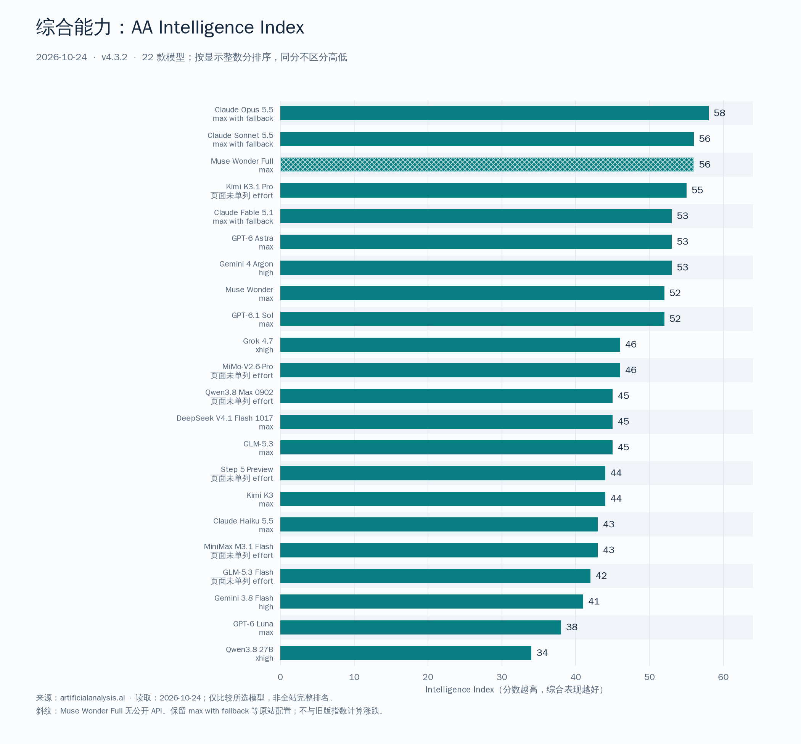
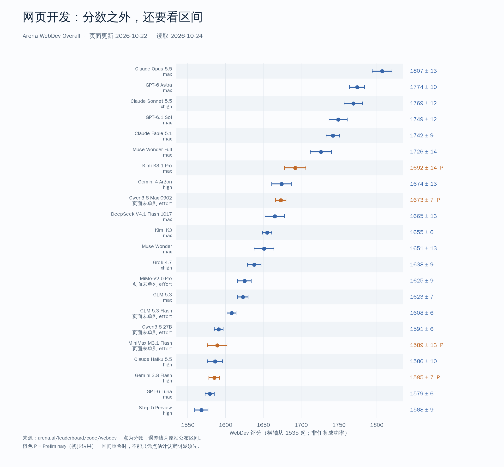
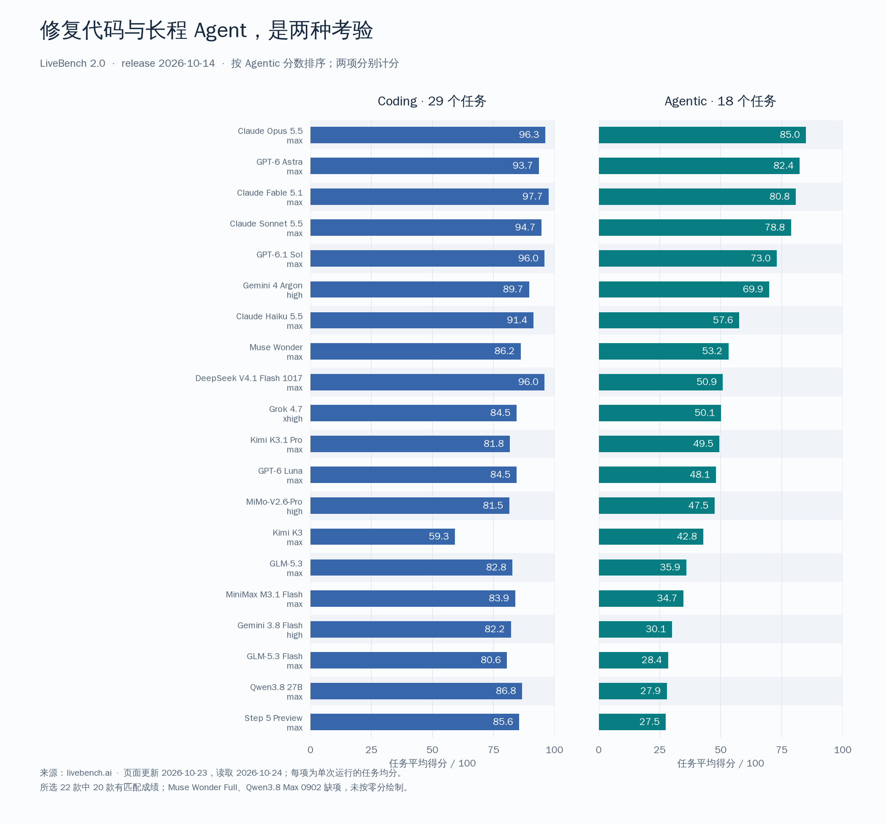
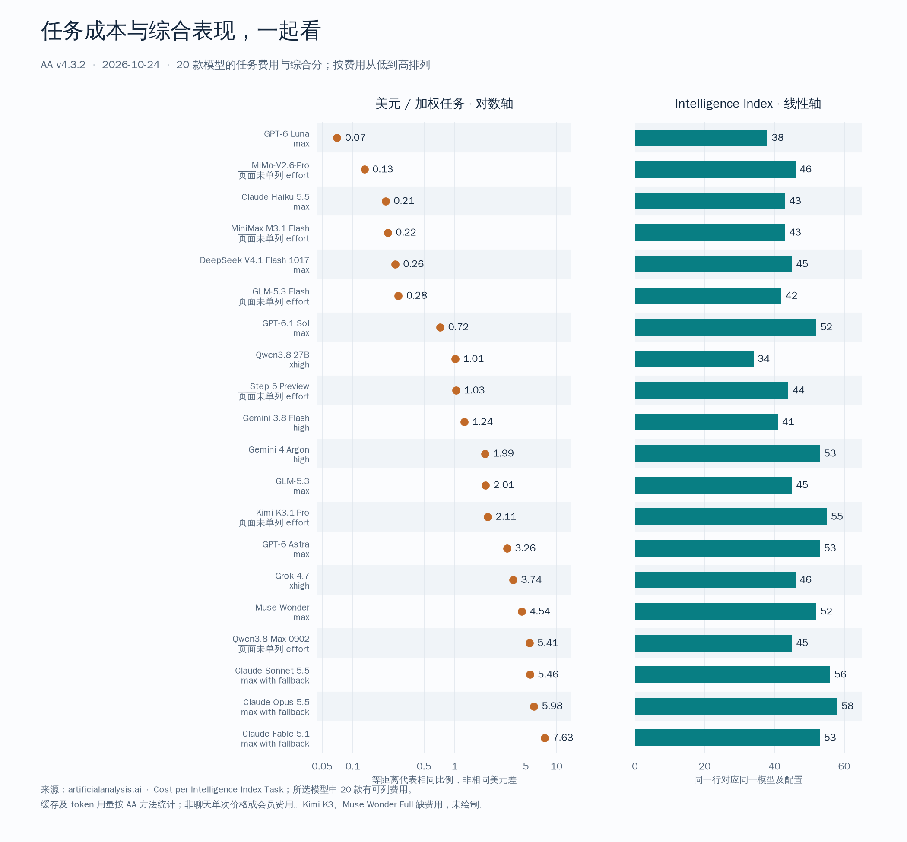

# 2026年10月主流大模型能力对比：Kimi K3.1 Pro、DeepSeek V4.1 Flash、MiniMax M3.1 Flash、GPT-6 Astra 怎么选

**数据截至 2026 年 10 月 24 日（北京时间）。** 主要来源：[Artificial Analysis](https://artificialanalysis.ai/leaderboards/models)、[Arena WebDev](https://arena.ai/leaderboard/code/webdev)、[LiveBench 2.0](https://livebench.ai/)，工程任务补充参考 [DeepSWE](https://deepswe.datacurve.ai/)。本文整理公开评测与官方资料，未进行作者自测。

**本期变化（2026-10-24，相较2026-09-07）：**

- **Kimi K3.1 Pro 的综合与编程表现明显高于 K3。** 两者在本期同版 AA 中为 55 和 44，LiveBench Coding 为 81.8 和 59.3；Research 则为 77.9 和 79.0，新版并非所有分项都领先。
- **DeepSeek V4.1 Flash 1017 的 Coding 表现值得关注。** LiveBench Coding 为 96.0，与 Sol 显示分相同；Agentic 为 50.9，仍低于 Sol。它适合进入边界明确、可用测试验收的编程任务候选，不能只凭 Coding 同分推断整个工程流程的能力相同。
- **低成本候选增加了新的选择。** MiMo V2.6 Pro、MiniMax M3.1 Flash、GPT-6 Luna、Haiku 5.5 等在 AA 任务费用上值得比较。费用优势需与完成质量、重试和人工修补一起衡量，不直接换算成会员额度。
- **Claude Opus 5.5 在本期 AA 与 WebDev 所选模型中领先。** Sonnet 5.5 也进入综合能力前列；Fable 5.1 则在本期 LiveBench 候选中总分最高，旗舰选择要结合具体任务。
- **GPT-6.1 Sol 成为日常编程的重要候选。** LiveBench Coding 为 96.0，Agentic 为 73.0；Astra 的 Agentic 为 82.4，在长程任务中仍有优势。同一 AA 任务成本口径下，Sol max 的费用约为 Astra max 的 22.1%。
- **工程成绩的来源需要分清。** DeepSWE 公开默认页仍标注 9 月 22 日，DeepSeek、MiniMax、MiMo 和 Meta 公布的新型号成绩属于厂商报告，不能与旧榜直接合并排名。

## 先按任务选，再看综合排名

选日常主力，关键是任务有多长、结果能否验收，以及完成后还要修补多少。综合分、Coding 和网页开发榜单各回答一部分问题，不能用一个名次决定所有工作。

- **修 Bug、补测试、需求明确的开发，把 Fable、Sol 与 DeepSeek 1017 放在一起比较。** Fable 的 Coding 更高，DeepSeek 的 AA 任务费用较低，Sol 的长程成绩高于 DeepSeek；由人拆解和验收时，重点看实际修改质量与修补成本。
- **复杂需求与网页原型，比较 Opus、Astra、Sonnet、Sol；国产候选中重点看 Kimi Pro、Qwen Max 0902 与 DeepSeek。** Kimi 在所选国产型号的综合与网页表现中靠前，但这不改变海外前列型号在 WebDev 上更高的成绩。
- **高频调用，比较 Luna、MiMo、Haiku、MiniMax 与 DeepSeek。** 它们位于 AA 低费用一侧，适合用相同任务比较返工后的总成本；不能只凭每次调用便宜就确定主力。

**需要模型长时间自主推进复杂工程，Opus 5.5、GPT-6 Astra 等仍有更强的长程成绩支撑。** 日常任务与复杂任务可以分别选模型，让能力、费用和人工接管共同决定分工。

## 一、22 款模型快速对比

本期选取 22 款模型。AA 使用 **Intelligence Index v4.3.2**；WebDev 页面更新于 **10 月 22 日**；LiveBench 使用 **2026-10-14 release**，页面更新于 **10 月 23 日**。这些成绩对应不同任务，不能相加成总分；AA 上期为 v4.2，也不能直接计算新旧指数的涨跌。

按 AA 页面显示的整数分从高到低排列，同分顺序不表示胜负。上下文单位为 token，1M 表示百万级；模型的最大窗口也不代表每个评测实际用了这么长的输入。“输入”仅列已确认或明确归因的材料类型，不代表图像、语音或视频生成能力。

| 模型 | 上下文 | 输入 | AA v4.3.2 | WebDev | LB Coding | LB Agentic |
|---|---|---|---|---|---|---|
| Claude Opus 5.5 | [1M](https://platform.claude.com/docs/en/about-claude/models/overview) | 文本、图像 | 58 | 1807 | 96.3 | 85.0 |
| Claude Sonnet 5.5 | [1M](https://platform.claude.com/docs/en/about-claude/models/overview) | 文本、图像 | 56 | 1769 | 94.7 | 78.8 |
| Muse Wonder Full | [1M](https://dev.meta.ai/models/muse-wonder) | 文本、图像 | 56 | 1726 | — | — |
| Kimi K3.1 Pro | [1M](https://platform.kimi.com/docs/guide/kimi-k3-1-pro-quickstart) | 文本、图像 | 55 | 1692 P | 81.8 | 49.5 |
| Claude Fable 5.1 | [1M](https://platform.claude.com/docs/en/about-claude/models/overview) | 文本、图像 | 53 | 1742 | 97.7 | 80.8 |
| GPT-6 Astra | [1,050,000](https://developers.openai.com/api/docs/models) | 文本、图像 | 53 | 1774 | 93.7 | 82.4 |
| Gemini 4 Argon | [1M](https://artificialanalysis.ai/models/gemini-4-argon) | 文本、图像（AA） | 53 | 1674 | 89.7 | 69.9 |
| Muse Wonder | [1,048,576](https://dev.meta.ai/docs/overview) | 文本、图像 | 52 | 1651 | 86.2 | 53.2 |
| GPT-6.1 Sol | [1,050,000](https://developers.openai.com/api/docs/models/gpt-6.1-sol) | 文本、图像 | 52 | 1749 | 96.0 | 73.0 |
| Grok 4.7 | [500,000](https://docs.x.ai/developers/models/grok-4.7) | 文本、图像 | 46 | 1638 | 84.5 | 50.1 |
| MiMo-V2.6-Pro | [1M](https://huggingface.co/XiaomiMiMo/MiMo-V2.6-Pro-RL) | 文本、图像、视频、语音 | 46 | 1625 | 81.5 | 47.5 |
| Qwen3.8 Max 0902 | [1M](https://www.qianwenai.com/models/qwen3.8-max-0902) | 文本、图像 | 45 | 1673 P | — | — |
| DeepSeek V4.1 Flash 1017 | [1M](https://huggingface.co/deepseek-ai/DeepSeek-V4.1-Flash-1017) | 文本、图像 | 45 | 1665 | 96.0 | 50.9 |
| GLM-5.3 | [1M](https://docs.z.ai/guides/llm/glm-5.3) | 文本 | 45 | 1623 | 82.8 | 35.9 |
| Step 5 Preview | [1M](https://artificialanalysis.ai/models/step-5) | 文本、图像（AA） | 44 | 1568 | 85.6 | 27.5 |
| Kimi K3 | [1M](https://artificialanalysis.ai/models/kimi-k3) | 文本、图像 | 44 | 1655 | 59.3 | 42.8 |
| Claude Haiku 5.5 | [1M](https://platform.claude.com/docs/en/about-claude/models/overview) | 文本、图像 | 43 | 1586 | 91.4 | 57.6 |
| MiniMax M3.1 Flash | [1M](https://platform.minimax.io/docs/guides/models-intro) | 文本、图像 | 43 | 1589 P | 83.9 | 34.7 |
| GLM-5.3 Flash | [1M](https://huggingface.co/zai-org/GLM-5.3-Flash) | 文本、图像 | 42 | 1608 | 80.6 | 28.4 |
| Gemini 3.8 Flash | [1M](https://artificialanalysis.ai/leaderboards/models) | 见官方接入说明 | 41 | 1585 P | 82.2 | 30.1 |
| GPT-6 Luna | [1,050,000](https://developers.openai.com/api/docs/models) | 文本、图像 | 38 | 1579 | 84.5 | 48.1 |
| Qwen3.8 27B | [262,144（原生）](https://huggingface.co/Qwen/Qwen3.8-27B) | 文本、图像、视频 | 34 | 1591 | 86.8 | 27.9 |

“—”表示没有可列的同版本成绩，不是零分。WebDev 的 **P** 表示 Preliminary，即初步结果。各榜单的思考档位并不完全一致：例如 Sonnet 5.5 在 AA 为 max with fallback、WebDev 为 xhigh；Haiku 5.5 在 AA 为 max、WebDev 为 high。详细配置和 WebDev 区间见后面的配置表。

规格中有几处值得留意：

- Claude 四款型号为 1M、文本与图像输入；OpenAI 三款型号的窗口为 1,050,000，常被榜单简写为 1M 或 1.1M。来源：[Claude 模型总览](https://platform.claude.com/docs/en/about-claude/models/overview)、[OpenAI 模型总览](https://developers.openai.com/api/docs/models)、[Sol 规格](https://developers.openai.com/api/docs/models/gpt-6.1-sol)。
- Qwen3.8 Max 0902 官方列 1M 总窗口，AA 显示 984k；最大输入长度与总窗口不能混为一谈。Qwen3.8 27B 原生为 262,144，官方提到可通过 RoPE／YaRN 扩展到 1M，不能直接当作原生 1M。来源：[Max 0902 规格](https://www.qianwenai.com/models/qwen3.8-max-0902)、[27B 官方模型卡](https://huggingface.co/Qwen/Qwen3.8-27B)。
- 表中标“AA”的输入类型来自该评测站规格；Gemini 3.8 Flash 的输入细项未在本期逐项列出，不表示它只接受文本。Muse Wonder 仅列文本与图像，不在这里展开所有媒体接入形式。来源：[Argon](https://artificialanalysis.ai/models/gemini-4-argon)、[Step 5 Preview](https://artificialanalysis.ai/models/step-5)、[Meta 接入文档](https://dev.meta.ai/docs/overview)。
- **GLM-5.3 为纯文本模型，GLM-5.3 Flash 支持图像输入**；有截图的工作流需要分清两者。来源：[GLM-5.3 文档](https://docs.z.ai/guides/llm/glm-5.3)、[Flash 模型卡](https://huggingface.co/zai-org/GLM-5.3-Flash)。

## 二、综合能力：Kimi 靠前，DeepSeek 的编程长处要看分项

### AA：先缩小候选范围

AA Intelligence Index 汇总推理、代码、Agent 和通用任务，适合初步判断模型覆盖复杂需求的能力。它主要基于文本任务，不能代替图像理解、语音或视频专项评测。当前版本与上期不同，同一个模型的绝对分数也可能变化。来源：[AA 评测方法](https://artificialanalysis.ai/methodology/intelligence-benchmarking)。

图源：[AA 本期所选 22 款模型](https://artificialanalysis.ai/?models=step-5%2Cglm-5-3-flash%2Cmimo-v2-6-pro%2Cgpt-6-astra%2Cclaude-opus-5-5%2Cclaude-fable-5-1%2Cgrok-4-7%2Ckimi-k3-1-pro%2Cgpt-6-luna%2Cclaude-haiku-5-5%2Cgemini-3-8-flash%2Cqwen3-8-27b%2Cqwen3-8-max%2Cclaude-sonnet-5-5%2Cgpt-6-1-sol%2Cglm-5-3%2Cgemini-4-argon%2Cminimax-m3-1-flash%2Cmuse-wonder-full%2Cdeepseek-v4-1-flash-1017%2Cmuse-wonder%2Ckimi-k3)，2026-10-24 读取并重绘。保留原站 max、high、xhigh 与 max with fallback 标签；同分顺序不表示强弱。斜纹表示 Muse Wonder Full 没有公开 API。这是所选模型比较，并非全站所有型号排名。

**Kimi K3.1 Pro 是本期所选国产候选中 AA 综合分最高的一款，适合先纳入复杂需求的试用名单。** MiMo Pro 的 AA 高于 Qwen Max 0902、DeepSeek 1017 与 GLM-5.3，后三者显示同样的整数分。这只能说明综合任务上的大致位置，不能据此给所有编程场景排出固定顺序。

DeepSeek 1017 的 AA 低于 Kimi Pro，LiveBench Coding 却更高；MiniMax、MiMo 在低费用任务上的取舍也不能只看 AA。**在国产候选中，覆盖多类工作可重点比较 Kimi，边界明确的代码修改则要把 DeepSeek 放进同一轮测试。**

Opus 5.5 位于 AA 最前面，Sonnet 5.5 与 Muse Wonder Full 紧随其后。对复杂综合任务，这些成绩构成更强的候选依据；Kimi 的国产组领先不能直接解释为全体模型领先。日常任务则还要结合具体分项与费用。

Muse Wonder Full 的可用性尤其需要单独看。榜上有成绩，不代表能够直接接进自己的生产流程；AA 将它标为没有公开 API。普通 Muse Wonder 与 Full 也不是可以互换成绩的同一个条目。来源：[Muse Wonder Full 的 AA 页面](https://artificialanalysis.ai/models/muse-wonder-full)、[Meta 模型说明](https://dev.meta.ai/models/muse-wonder)。

### LiveBench：总分相近，擅长的工作可能不同

LiveBench 2.0 覆盖 Agentic、Reasoning、Coding、Browser Use、Data Analysis、Research 和 Design 七套任务。本期 release 的 Overall 是有成绩套件的等权均值，包含浏览器操作、研究报告和文档制作等工作，不只是在代码题上取平均。来源：[LiveBench 榜单](https://livebench.ai/)、[方法说明](https://livebench.ai/#/methodology)。

下面列出部分重点候选，按 LiveBench 总分排序。总分由七套任务计算，表中只展开与选型讨论有关的几个分项。

| 模型 | Overall | Coding | Agentic | Browser | Data Analysis | Research | Reasoning |
|---|---|---|---|---|---|---|---|
| Claude Fable 5.1 | 88.0 | 97.7 | 80.8 | 100.0 | 80.3 | 82.0 | 91.7 |
| Claude Opus 5.5 | 86.5 | 96.3 | 85.0 | 80.0 | 80.3 | 85.0 | 92.2 |
| GPT-6 Astra | 86.1 | 93.7 | 82.4 | 84.0 | 83.0 | 85.2 | 92.7 |
| GPT-6.1 Sol | 85.4 | 96.0 | 73.0 | 88.0 | 82.7 | 83.5 | 92.6 |
| Gemini 4 Argon | 84.1 | 89.7 | 69.9 | 92.0 | 85.2 | 83.1 | 95.1 |
| Claude Sonnet 5.5 | 82.5 | 94.7 | 78.8 | 84.0 | 59.5 | 83.6 | 91.6 |
| DeepSeek V4.1 Flash 1017 | 79.2 | 96.0 | 50.9 | 76.0 | 79.5 | 79.5 | 89.1 |
| Muse Wonder | 78.1 | 86.2 | 53.2 | 72.0 | 81.6 | 88.0 | 90.6 |
| Kimi K3.1 Pro | 76.7 | 81.8 | 49.5 | 80.0 | 79.1 | 77.9 | 91.1 |
| Claude Haiku 5.5 | 75.6 | 91.4 | 57.6 | 80.0 | 53.1 | 81.9 | 82.4 |
| MiMo-V2.6-Pro | 74.9 | 81.5 | 47.5 | 88.0 | 72.3 | 76.7 | 79.6 |
| Grok 4.7 | 74.1 | 84.5 | 50.1 | 60.0 | 76.9 | 86.4 | 82.7 |
| MiniMax M3.1 Flash | 73.1 | 83.9 | 34.7 | 92.0 | 71.4 | 72.7 | 82.9 |

国产候选的差别比一个总分更有用：DeepSeek 1017 的 Coding 突出，Kimi Pro 的 Reasoning 较强；MiniMax 的 Browser Use 高于 MiMo，MiMo 的 Agentic 又高于 MiniMax。修代码、浏览器操作、持续推进任务，应分别看对应分项。

**混合办公与编程，Fable 5.1 仍值得保留在首轮名单；更重视持续推进任务，优先看 Opus 与 Astra。** Argon 的推理、数据分析和 Muse Wonder 的研究分项也各有优势。挑主力应围绕最常做的工作：代码修改占大头，就给 Coding 更高权重；报告、表格和浏览器操作混在一起，就看对应分项是否均衡。

## 三、网页开发：看成品偏好，也看分数区间

Arena WebDev 让用户比较模型生成的网页并投票，更接近“这份页面成品更符合需求吗”。做前端原型、页面迭代和 Vibe Coding，它是有价值的参考；接手一个大型仓库、排查隐蔽 Bug，则还需要工程任务的证据。来源：[Arena WebDev](https://arena.ai/leaderboard/code/webdev)。

图源：[Arena WebDev Overall](https://arena.ai/leaderboard/code/webdev)，页面更新 2026-10-22，2026-10-24 读取并重绘。点为分数，误差线保留原站公布区间；横轴从 1535 起，分数不是百分比。P 表示初步结果。

**做前端原型，国产候选优先比较 Kimi K3.1 Pro、Qwen3.8 Max 0902 与 DeepSeek 1017。** Kimi Pro 的点估计在这组中较高，Kimi 与 Qwen 都仍带初步结果标记；Qwen 与 DeepSeek 的区间重叠，不宜把相邻名次解释为稳定优势。试用时应拿同一份页面需求，检查交互、布局和后续修改，而不只看首屏观感。

Opus 5.5、Astra、Sonnet 5.5、Sol 和 Fable 5.1 占据本期所选模型的前五位。**若优先追求网页成品质量，先从 Opus 与 Astra 开始；更在意费用，再比较 Sol 和国产候选。** 相邻型号的区间有重叠，已经用顺手的模型不必因为几分差距就更换；需求完成度、交互细节和第二轮修改质量，比名次的小幅变化更值得看。

### 配置与区间

同一个模型在不同平台可能采用不同思考档位。以下按 WebDev 分数排列，把 AA、WebDev 和 LiveBench 的配置放在一起；“未单列”表示原站该条目没有另写 effort，不替它推定为 max。

| 模型 | AA effort | WebDev effort | WebDev 分数及区间 | LiveBench effort |
|---|---|---|---|---|
| Claude Opus 5.5 | max with fallback | max | 1807 ± 13 | max |
| GPT-6 Astra | max | max | 1774 ± 10 | max |
| Claude Sonnet 5.5 | max with fallback | xhigh | 1769 ± 12 | max |
| GPT-6.1 Sol | max | max | 1749 ± 12 | max |
| Claude Fable 5.1 | max with fallback | max | 1742 ± 9 | max |
| Muse Wonder Full | max | max | 1726 ± 14 | — |
| Kimi K3.1 Pro | 未单列 | max | 1692 ± 14 P | max |
| Gemini 4 Argon | high | high | 1674 ± 13 | high |
| Qwen3.8 Max 0902 | 未单列 | 未单列 | 1673 ± 7 P | — |
| DeepSeek V4.1 Flash 1017 | max | max | 1665 ± 13 | max |
| Kimi K3 | max | max | 1655 ± 6 | max |
| Muse Wonder | max | max | 1651 ± 13 | max |
| Grok 4.7 | xhigh | xhigh | 1638 ± 9 | xhigh |
| MiMo-V2.6-Pro | 未单列 | 未单列 | 1625 ± 9 | high |
| GLM-5.3 | max | max | 1623 ± 7 | max |
| GLM-5.3 Flash | 未单列 | 未单列 | 1608 ± 6 | max |
| Qwen3.8 27B | xhigh | 未单列 | 1591 ± 6 | max |
| MiniMax M3.1 Flash | 未单列 | 未单列 | 1589 ± 13 P | max |
| Claude Haiku 5.5 | max | high | 1586 ± 10 | max |
| Gemini 3.8 Flash | high | high | 1585 ± 7 P | high |
| GPT-6 Luna | max | max | 1579 ± 6 | max |
| Step 5 Preview | 未单列 | high | 1568 ± 9 | max |

来源：[AA 模型榜](https://artificialanalysis.ai/leaderboards/models)、[Arena WebDev](https://arena.ai/leaderboard/code/webdev)、[LiveBench](https://livebench.ai/)，均为 2026-10-24 所读数据。AA 的 fallback 标签是成绩配置的一部分，不应去掉后把它解释成另一套运行方式。

## 四、修 Bug 与长程 Agent：DeepSeek 和 Sol 的同分意味着什么

LiveBench 的 **Coding 有 29 个任务**，要求在固定快照的大型生产代码库中修复真实 Bug；**Agentic 有 18 个任务**，涉及连续业务变化、模拟多个月运行、系统工程和优化任务。后者要求前面的决策在后续轮次中仍然成立。两项都涉及工具与代码，但承担的工作长度和约束不同。来源：[LiveBench 方法说明](https://livebench.ai/#/methodology)。

图源：[LiveBench 2.0](https://livebench.ai/)，release 2026-10-14，页面更新 10 月 23 日，10 月 24 日读取并重绘。显示各模型的实际 effort；每项为单次运行的任务均分。所选模型中，Muse Wonder Full 与 Qwen3.8 Max 0902 没有可列的对应成绩，未按零分绘制。

**DeepSeek 1017 与 Sol 的 Coding 均为 96.0，Agentic 分别为 50.9 和 73.0。** 对于定位明确的 Bug、可运行的测试、能清楚验收的修改，两者都值得比较，DeepSeek 的较低 AA 任务成本是一个优势；如果任务会持续变更需求，需要模型自主维护多轮状态，Sol 更高的 Agentic 成绩提供了另一层选择理由。Astra、Opus 在长程任务上的成绩还要更高。

Kimi Pro、MiMo Pro 的长程分项也低于 Coding，MiniMax、GLM Flash 和 Step 的差距更明显。**这些型号更适合承担拆好、能验收的一段工作；跨多轮需求、需要持续维护状态的任务，则优先交给 Agentic 更强的候选。** 这是一种比“所有任务都用最贵”或“所有任务都用最便宜”更合理的分工：明确修改控制费用，复杂推进减少接管。

这些分数也有实验限制。LiveBench 每套任务是单次运行；遇到工具或供应商故障、重跑一次仍无法测量的任务，会记为零分。因此，任务均分不能直接解释成“在你的仓库里有多少成功率”，接近的显示分也不是经过多次运行证明的稳定优势。来源：[计分与重试规则](https://livebench.ai/#/methodology)。

GLM-5.3 的例子尤其说明了总分的边界：它是纯文本模型，Browser Use 使用截图，当前该项为 0，拉低了 Overall。这个结果确实反映它无法完成该输入形式的任务，却不能单独用来断定它处理文本代码的能力。GLM-5.3 Flash 支持图像输入，在包含截图的流程中需要另行考虑。

### DeepSWE：旧榜与新型号官方成绩分别看

DeepSWE 更贴近仓库工程任务，但本期读取的默认视图仍标注 **2026-09-22**，为 v1.1、113 个任务，并说明使用 mini-swe-agent。已有成绩可以继续参考，却不能把旧型号的成绩自动归给新型号。来源：[DeepSWE 原站](https://deepswe.datacurve.ai/)。

| DeepSWE 原站型号 | 配置 | 成绩及原站区间 |
|---|---|---:|
| GPT-6 Astra | xhigh | 74% ± 3% |
| Gemini 3.8 Flash | high | 74% ± 1% |
| Claude Opus 5（旧版） | max | 74% ± 4% |
| GLM-5.3 | max | 69% ± 3% |
| Kimi K3 | max | 69% ± 5% |
| GLM-5.3 Flash | max | 63% ± 4% |

新型号另有厂商公布的 DeepSWE 成绩。下面按来源分别列出，不与上表合并排名：

| 厂商公开结果 | 报告成绩 | 来源与条件 |
|---|---:|---|
| DeepSeek V4.1 Flash 1017 | 77.0% | [官方模型卡](https://huggingface.co/deepseek-ai/DeepSeek-V4.1-Flash-1017)，注明 Mini-SWE-V2 |
| MiniMax M3.1 Flash | 73.7% | [官方发布](https://www.minimax.io/blog/minimax-m31f)，不视为已与原站配置对齐 |
| MiMo V2.6 Pro | 71.9% | [官方模型卡](https://huggingface.co/XiaomiMiMo/MiMo-V2.6-Pro-RL)，按厂商报告归因 |
| Muse Wonder Full / Wonder | 79.0% / 78.8% | [Meta 模型页](https://dev.meta.ai/models/muse-wonder)，厂商汇总表 |

这些厂商结果让 DeepSeek、MiniMax 与 MiMo 更值得进入工程任务试用名单，但与旧榜的框架和参数未完全对齐，不能按百分比混排。**本期选择长程工程主力，优先采用同一 release 的 LiveBench Agentic 作横向参考；DeepSWE 的新报告作为补充，不据此改写领先顺序。**

## 五、国产模型逐一看：长处、短板与适用任务

### Kimi K3.1 Pro：国产综合表现靠前，长程仍有差距

**Kimi K3.1 Pro 的长处是所选国产型号中靠前的综合与网页表现。** 它适合纳入复杂需求理解、带截图的页面迭代，以及代码与资料混合工作的测试名单；Opus、Sonnet 等更高的综合与网页成绩也应同时考虑。

Kimi K3.1 Pro 与 K3 在**同一版 AA**中分别为 55 和 44；LiveBench Coding 从 K3 的 59.3 到 Pro 的 81.8，Agentic 为 42.8 与 49.5。**已经在用 K3 写代码、做页面的读者，Pro 是值得优先试的升级；同时处理代码、截图与资料，也更适合把它作为国产综合候选来考虑。**

单看代码修改，DeepSeek 1017 的 Coding 更高；长程自主工程，Opus、Astra 更强。**Kimi Pro 的吸引力在于多类需求的覆盖，而非每个单项都争第一。** Research 为 Pro 77.9、K3 79.0，主要做检索和报告的 K3 用户可以先保留原有工作流，把升级优先留给编程和页面任务。

Kimi Pro 已提供线上服务，官方计划在 **11 月 4 日前**发布完整权重；计划日期不等于权重已经开放。来源：[Kimi 官方发布](https://www.kimi.com/en/blog/kimi-k3-1-pro)、[API 指南](https://platform.kimi.com/docs/guide/kimi-k3-1-pro-quickstart)。产品入口：[Kimi / Kimi Code](https://api.dreamfree.space/c/s/cpyqkimi/20261024)。

### DeepSeek 1017：代码修改有竞争力，长程仍需比较

本期采用 **V4.1 Flash 1017**，与早期 V4 Flash、V4 Pro 或未带 1017 后缀的版本分开。官方这次更新强调编程与工具能力，模型卡也给出了工程任务成绩。来源：[10 月 17 日发布](https://api-docs.deepseek.com/zh-cn/news/news261017/)、[1017 模型卡](https://huggingface.co/deepseek-ai/DeepSeek-V4.1-Flash-1017)。

**DeepSeek 是本期最值得关注的国产日常代码候选之一，理由是突出的 Coding 与较低的 AA 任务费用同时出现。** 它的 LiveBench Coding 为 96.0，AA 任务成本为 0.26 美元。修 Bug、补测试、实现验收条件明确的功能，值得把它与 Sol、Fable 放进同一轮测试；愿意自己审查代码的读者，尤其值得看它能省下多少费用。这组费用按 AA 的任务集计算，不是每次调用报价。

它的 Agentic 为 50.9，低于 Sol、Astra、Opus。**希望少拆任务、少接管，优先考虑后面这些长程更强的候选；愿意管理任务边界与测试，DeepSeek 的取舍就更有吸引力。** 调用时认准 1017 版本，这个判断不直接套用到所有 DeepSeek 型号。

产品入口：[DeepSeek API 按量](https://api.dreamfree.space/c/s/cpyqdeepseek/20261024)。

### MiniMax 与 MiMo：高频任务按分项与返工成本取舍

**MiMo V2.6 Pro** 的 AA 综合分高于 MiniMax M3.1 Flash，所列 AA 任务费用也更低；LiveBench 中，MiniMax 的 Coding 与 Browser Use 较高，MiMo 的 Agentic 较高。两者已经足以说明：综合分、单项能力和成本各自提供一部分答案。

**只在这两款中选，代码修改与浏览器操作更偏向 MiniMax；多模态输入、较长任务和 AA 费用更偏向 MiMo Pro。** MiniMax 的 Browser Use 为 92.0，说的是浏览器操作，不是网页生成。两者更适合在高频、可拆分任务中争取成本优势；长程自主工程仍优先考虑旗舰，并把 Luna、Haiku 一起纳入低费用对照。

MiMo 的官方材料介绍了多模态能力；比较时仍要区分托管 API 与发布的 RL 等检查点，不能把每种部署形态都视为同一套榜单运行。MiniMax 在 10 月 19 日公告中称权重将后续发布，不能仅凭榜单的开放标签就认定已经可以下载。来源：[MiMo 官方模型卡](https://huggingface.co/XiaomiMiMo/MiMo-V2.6-Pro-RL)、[MiMo AA 页面](https://artificialanalysis.ai/models/mimo-v2-6-pro)、[MiniMax 发布](https://www.minimax.io/blog/minimax-m31f)。

产品入口：[MiMo](https://api.dreamfree.space/c/s/cpyqmimo/20261024)、[MiniMax Coding Plan / Token Plan](https://api.dreamfree.space/c/s/cpyqminimax/20261024)。先用相同需求、相同验收条件比较通过率，再看完成一个任务的实际花费。

### GLM：文本代码与截图任务分开选

**GLM-5.3 与 GLM-5.3 Flash** 的 AA、WebDev 表现相近，但输入能力和长程分项有差异。纯文本代码任务可以比较两者；截图驱动的任务需要图像输入，Flash 才是这两款中对应的候选。产品入口：[GLM Coding Plan](https://api.dreamfree.space/c/s/cpyqzhipu/20261024)。

**在这两款中，纯文本代码任务先试 GLM-5.3，需要读截图则选 Flash。** GLM-5.3 的 Browser Use 为零来自截图输入限制，文本代码应看 Coding；两款的长程成绩都不是本期强项。已有 GLM 工作流可以按输入需求分工，目标若是尽量少接管的自主工程，则更值得同时试 Opus、Astra 或 Sol。规格来源：[GLM-5.3 文档](https://docs.z.ai/guides/llm/glm-5.3)、[Flash 模型卡](https://huggingface.co/zai-org/GLM-5.3-Flash)。

### Qwen：已有百炼用户的网页开发候选

**Qwen3.8 Max 0902** 在所选国产模型的 WebDev 成绩中较突出，目前仍为初步结果。本期没有可列的同版本 LiveBench 数据，因此无法用它补全长程 Agentic 判断。选择百炼服务时，也应核对实际模型版本，而不只看“Max”这个名称。规格来源：[Qwen3.8 Max 0902](https://www.qianwenai.com/models/qwen3.8-max-0902)；产品入口：[百炼 Coding Plan](https://api.dreamfree.space/c/s/cpyqbailianc/20261024)、[百炼 Token Plan](https://api.dreamfree.space/c/s/cpyqbailiant/20261024)。

**已经接入百炼、主要做页面原型，Qwen Max 0902 值得留在首轮测试里；专门为长程自主工程选主力，本期更推荐 Opus、Astra 等已有较强对应成绩的型号。** Qwen 的实际吸引力是网页表现与现有百炼工作流的结合，页面做得好就继续用，不必仅为换一个品牌再添接入；也不需要为了凑齐所有场景而把它用于每一种任务。

### Step：先用于可拆分、可验收的代码任务

**Step 5 Preview 更适合拆好的代码修改，暂不作为少接管的长程主力优先推荐。** 它的 Coding 与 Agentic 差距明显：已有 Step 接入，可以先让它承担有测试、能单独验收的修改；如果从零选择日常编程主力，先比较 DeepSeek、Sol 等候选更有理由，不必为了多一个型号把工作流弄复杂。来源：[Step 官方技术说明](https://platform.stepfun.com/blog/inside-step-5-preview)、[LiveBench](https://livebench.ai/)。产品入口：[阶跃星辰](https://api.dreamfree.space/c/s/cpyqstepfun/20261024)。

### 海外模型：长程工程与专项任务中的领先候选

**复杂长程工程仍值得比较 Opus 5.5 与 GPT-6 Astra。** 两者的 Agentic 在本期所选模型中靠前，Opus 同时领先 AA 与 WebDev。Sonnet 5.5 也可比较日常工程质量；Fable 5.1 的 LiveBench 总分与 Coding 仍强，已有稳定工作流不必只因新品出现就替换。Haiku 5.5 则可用于预算敏感、可拆分的代码任务。规格见 [Claude 文档](https://platform.claude.com/docs/en/about-claude/models/overview)，产品入口：[Claude 订阅](https://api.dreamfree.space/c/s/cpyqclaudeup/20261024)。

**GPT-6.1 Sol 是日常编程的主力候选之一。** 它的 Coding 高于 Astra、Agentic 低于 Astra，AA 同组任务费用约为 Astra 的 22.1%；GPT-6 Luna 则属于低成本候选。它们与 DeepSeek、Kimi、MiniMax、MiMo 的取舍，都应比较任务完成质量、费用与人工接管，不能从榜单 API 配置推算订阅额度。规格见 [OpenAI 模型文档](https://developers.openai.com/api/docs/models)，产品入口：[ChatGPT / Codex](https://api.dreamfree.space/c/s/cpyqchatgpt/20261024)。

普通 **Muse Wonder** 的 Research 表现值得研究报告类工作关注；**Wonder Full** 的 AA 成绩更高，但公开 API 限制影响实际接入。两者需要分别判断。来源：[Meta 模型页](https://dev.meta.ai/models/muse-wonder)。

**Gemini 4 Argon** 的推理与数据分析分项较突出，官方发布页仍描述分阶段访问；决定接入前应确认自己的账户与服务入口。**Gemini 3.8 Flash** 在本期 LiveBench 长程任务中与旗舰组存在差距，不能用旧 DeepSWE 的一个高分替代对当前具体工作流的判断。来源：[Argon 官方发布](https://blog.google/innovation-and-ai/models-and-research/gemini-models/gemini-4-argon/)、[Gemini 3.8 Flash 发布](https://blog.google/innovation-and-ai/models-and-research/gemini-models/3-8-flash-and-3-8-flash-cyber/)。

**Grok 4.7** 支持文本与图像，窗口为 500,000；本期 Research 分项较高，但网页开发与长程 Agentic 并未进入所选旗舰前列。已有 Grok 工作流的用户，可以重点测试自己需要的研究任务，而不必从综合名次推断所有用途。来源：[Grok 4.7 文档](https://docs.x.ai/developers/models/grok-4.7)、[LiveBench](https://livebench.ai/)。

## 六、成本：关心完成任务的代价，而不只看 token 单价

以下使用 AA 的 **Cost per Intelligence Index Task**，即按该评测权重统计的任务成本。AA 根据 token 用量、价格及典型缓存命中情况计算费用；思考档位、输出长度与工具过程都会影响结果。这不是一次聊天的报价，也不能直接换算成会员月额度。来源：[AA 方法与成本说明](https://artificialanalysis.ai/methodology/intelligence-benchmarking)。

图源：[AA 模型榜](https://artificialanalysis.ai/leaderboards/models)，v4.3.2，2026-10-24 读取并重绘。左侧为美元/加权任务，采用对数轴，等距离表示相同比例；右侧为线性刻度的综合分。每行保留同一 AA 配置。Muse Wonder Full 与 Kimi K3 未列出本期可用费用，故没有绘入成本图。

**低费用候选包括 Luna、MiMo Pro、Haiku、MiniMax 和 DeepSeek，选择时要同时看完成质量。** 这组 AA 任务中，Kimi Pro 的费用高于 MiMo Pro、MiniMax 和 DeepSeek，需要判断其综合能力能否减少足够多的返工。Sol 也提供了另一种能力与费用组合，不能仅按产地决定谁更划算。

两个同口径比值可以帮助理解量级：

| 对比 | AA 每任务费用 | 前者 / 后者 |
|---|---|---:|
| GPT-6.1 Sol max / GPT-6 Astra max | 0.72 / 3.26 美元 | 约 22.1% |
| DeepSeek 1017 max / GPT-6.1 Sol max | 0.26 / 0.72 美元 | 约 36.1% |

这些比例只对应 AA 这组任务和配置。换成更长上下文、不同缓存命中、额外重试或另一种 Agent 工具，真实账单可能不同。也不应将某个模型的 AA 费用与另一个模型的 DeepSWE 费用直接比较，它们执行的工作并不相同。

**费用敏感且能自己验收，先测 Luna、MiMo、Haiku、MiniMax、DeepSeek 等低费用候选；希望兼顾日常代码与较长任务，Sol 值得做主力对照；难题与长程任务再给 Opus、Astra。** 记录首次完成率、修补次数、总费用和人工介入时间。一次便宜但反复修补，未必比一次完成划算；反过来，能由低费用模型做好的一步，也没有必要始终用最高价的型号。

## 七、按任务选主力：能力、成本与人工接管一起比较

| 主要工作 | 可优先比较的候选 | 取舍与验收重点 |
|---|---|---|
| 日常修 Bug、补测试、明确功能开发 | Fable、Sol、DeepSeek 1017；预算敏感时比较 Haiku、MiniMax、GLM | Fable 的 Coding 更高；DeepSeek 费用较低、Sol 长程更强；检查实际修补次数 |
| 前端原型与页面迭代 | Opus、Astra、Sonnet、Sol；国产候选比较 Kimi Pro、Qwen Max 0902、DeepSeek | 海外前列型号的 WebDev 成绩更高；国产组中 Kimi 靠前，Kimi/Qwen 仍为初步结果 |
| 高频 API、可拆分的小任务 | Luna、MiMo Pro、Haiku、MiniMax、DeepSeek、GLM Flash | 比较完成任务的总费用，计入重试和人工修补 |
| 截图与多模态工作流 | 从支持所需输入的型号筛选；国产可比较 Kimi Pro、MiMo Pro、GLM Flash | 输入支持是门槛；具体 API 与真实材料上的效果仍需检验，GLM-5.3 不能接收截图 |
| 研究报告、资料与数据工作 | Muse Wonder、Grok、Argon、Astra、Fable；国产比较 Kimi 新旧两款、DeepSeek | 按 Research、Data Analysis 等对应分项筛选；核对引用与计算，不默认 Pro 全面替代 K3 |
| 复杂工程、多轮需求、长程 Agent | Opus、Astra、Fable、Sonnet；兼顾费用比较 Sol | 国产所列候选在 Agentic 上仍有差距；持续状态、需求变化与人工接管是关键 |

不必一次订齐，拿自己经常做的三五项任务，用相同材料和验收条件比较通过率、总费用与人工接管次数，再确定主力。明确任务可以试费用更低的候选，复杂或反复失败的任务再换用对应能力更强的型号。

## 八、结论：国产选择更丰富，长程能力仍有明确差距

**本期更值得调整的是任务分工：复杂工程与高要求网页优先考虑 Opus、Astra；日常代码在 Fable、Sol 与 DeepSeek 中挑主力，高频小任务再比较 Luna、MiMo、Haiku 和 MiniMax。** 国产候选里，Kimi Pro 更适合覆盖代码、截图与资料的混合需求，DeepSeek 更值得拿来比较明确代码任务的费用；已有 GLM、百炼或 Step 工作流，则按输入和任务长度决定是否继续使用。

**国产模型已经值得参与日常主力的竞争，海外旗舰在本期长程能力上仍更强，这两点同时成立。** 不必为了追新把所有工具换一遍，也不必让一个模型承担全部任务。先选一款日常主力和一个难题处理选项，只有重复任务的用量足够大，再增加低费用型号；让更少返工、更少接管和合理总成本决定最终分工。

---

模型与产品信息：[Coding Plan](https://vibecoding.dreamfree.space/) · [本期原文](https://vibecoding.dreamfree.space/articles/model_comparisons/20261024/)
