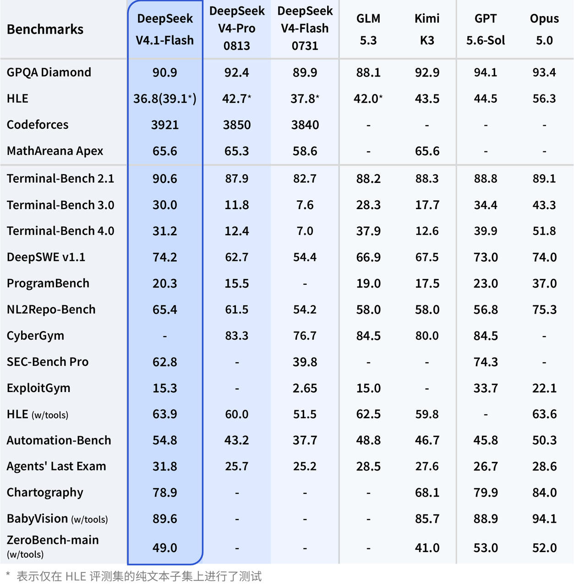
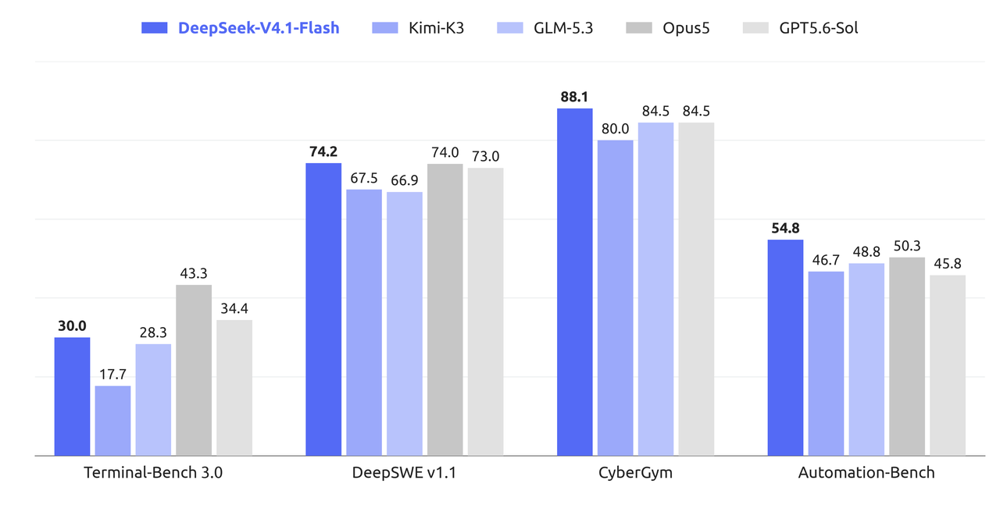
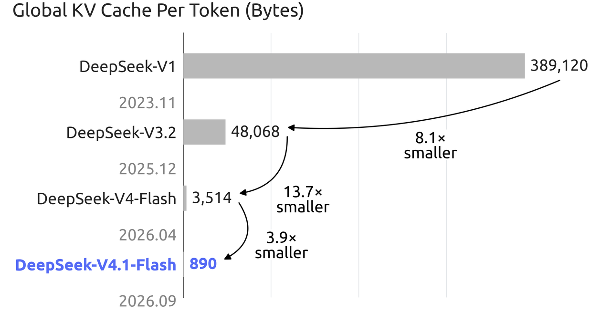
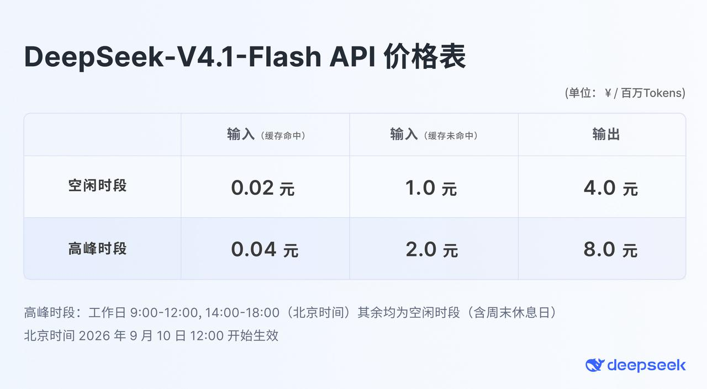

# DeepSeek V4.1 Flash 发布：552B 新架构、原生多模态，API 价格同步下调

**更新日期 2026.9.10** 数据来源 [https://vibecoding.dreamfree.space](https://vibecoding.dreamfree.space)

> 本次核心更新：
>
> - DeepSeek 于 9 月 10 日正式发布 V4.1 Flash，552B 参数 MoE，采用全新的 Causal-Encoder-Decoder 结构，输入激活 8B、输出激活 16B，原生支持多模态视觉理解。
> - 官方口径是「全面超越 V4 Pro」：Terminal-Bench 2.1 拿到 90.6，DeepSWE v1.1 为 74.2，Agent 类项目普遍高于自家 Pro 档。
> - KV Cache 压缩到约 890 字节/token，约为此前 V4-Flash 的 1/4，HBM 需求降到 1/4、SSD 需求降到 1/8，相对初代模型缩小 437 倍。
> - API 模型名改为 `deepseek-flash`，旧模型名暂时路由；北京时间 9 月 14 日 12:00 之后，`deepseek-v4-pro` 的请求全部路由到 V4.1 Flash 并按 Flash 价格计费。
> - 新价格自北京时间 9 月 10 日 12:00 起生效：空闲时段缓存命中输入 0.02 元、缓存未命中输入 1 元、输出 4 元（每百万 tokens），高峰时段为其两倍。
> - 腾讯 WorkBuddy（含 CodeBuddy）与 OpenCode 已全量接入；OpenCode Go 同期给出限时 4 倍额度。

DeepSeek 把全新模型结构系列里尺寸最小的一档换成了 V4.1 Flash。9 月 10 日发布当天，模型同步上线 DeepSeek API 并放出开源权重的技术报告（[官方发布页](https://www.deepseek.com/news/deepseek-v4-1-flash/)、[Hugging Face 模型卡](https://huggingface.co/deepseek-ai/DeepSeek-V4.1-Flash)、[技术报告](https://huggingface.co/deepseek-ai/DeepSeek-V4.1-Flash/blob/main/DeepSeek_V41_Tech_Report.pdf)）。这条产品线的定位很清楚：用一个重新设计的结构把长输入、长上下文的成本压下来，让 Agent 类工作负载更便宜。

## 一、新结构：输入和输出不再对称

V4.1 Flash 是 552B 参数的 MoE 模型，用的是全新的 Causal-Encoder-Decoder（CED，因果编码器—解码器）结构：整网 40 层 Transformer，由 20 层因果编码器和 20 层解码器组成。解码器不再各自从本层隐状态构造全局 KV，而是直接从编码器末层的隐状态投影得到。

这带来的直接结果是激活参数不对称：预填充阶段每 token 只激活 8B 参数，解码阶段每 token 激活 16B。Agent 任务通常是先读入很长的上下文、再一步步产出少量输出，把长输入阶段的算力压下来，省的正是成本大头。

注意力部分换成了 Compressed Sparse Attention 2（CSA2）：每个注意力层在 Full、Reindex、Reuse 三种模式里取一种，跨层共享主 KV 和索引器 K，并复用 Top-K 稀疏注意力索引；解码器里的分层稀疏索引器把深层索引限制在首层 Full 模式构造的候选池内，避免索引成本随上下文长度继续膨胀。主 KV 用 FP4 存储，每 16 个通道配一个缩放系数。

官方模型卡里还列了几处配套设计：Engram 条件记忆（196B 参数，按 token 查表稀疏访问）、Single-Pass mHC 残差混合与 DSpark 推测解码；每个 MoE 层有 1 个共享专家和 384 个路由专家，每个 token 激活其中 6 个。

规格上，上下文 1M，最大输出 384K，API 并发限制 2500，是 V4 Pro 的 5 倍；思考模式分 low / high / max 三档，默认 high；图像理解只有 Flash 支持，V4 Pro 不支持。

## 二、性能：Agent 向明显提升，推理类仍略低于 V4 Pro

官方公布的分数可以分成两组看：一组考模型自身的知识与推理，另一组考它在真实环境里调用工具、跑长任务的能力。下面两表的三列都是 DeepSeek 自家模型，前一组 V4.1 Flash 相比 V4 Pro 小幅回落，后一组是这次提升的主要来源。

**知识问答与推理**

| Benchmark | 考什么 | V4.1 Flash | V4 Pro 0813 | V4 Flash 0731 |
| --- | --- | ---: | ---: | ---: |
| GPQA Diamond | 博士级科学问答，物理、化学、生物的选择题 | 90.9 | 92.4 | 89.9 |
| HLE | Humanity's Last Exam，跨学科超难题集，考知识上限 | 36.8（纯文本子集 39.1） | 42.7 | 37.8 |
| MathArena Apex | 竞赛级数学题，偏证明与复杂计算 | 65.6 | 65.3 | 58.6 |

这一组里 HLE 的差距最明显（36.8 对 42.7），GPQA Diamond 也低 1.5 分，MathArena Apex 基本持平。所谓「全面超越 V4 Pro」是综合性能、费用、速度与总用时的口径，纯知识推理并不是每一项都领先。

**Agent 与工具使用**

| Benchmark | 考什么 | V4.1 Flash | V4 Pro 0813 | V4 Flash 0731 |
| --- | --- | ---: | ---: | ---: |
| Terminal-Bench 2.1 | 在真实终端里完成命令行任务，看工具调用与排错 | 90.6 | 87.9 | 82.7 |
| Terminal-Bench 3.0 | 同系列更长、更接近完整工程流程的任务 | 30.0 | 11.8 | 7.6 |
| Terminal-Bench 4.0 | 该系列当前最难的版本，任务链条最长 | 31.2 | 12.4 | 7.0 |
| DeepSWE v1.1 | 在真实代码库里定位并修复问题，考长程工程能力 | 74.2 | 62.7 | 54.4 |
| NL2Repo-Bench | 把自然语言需求写成可运行的仓库级代码 | 65.4 | 61.5 | 54.2 |
| CyberGym | 网络安全类任务 | 88.1 | 83.3 | 76.7 |
| SEC-Bench Pro | 软件安全缺陷的定位与修复 | 62.8 | — | 39.8 |
| ExploitGym | 漏洞利用类任务 | 15.3 | 5.4 | 1.8 |
| HLE（w/tools） | 允许调用工具后的 HLE 成绩 | 63.9 | 60.0 | 51.5 |
| Automation-Bench | 端到端自动化任务，考多步执行与自查 | 54.8 | 43.2 | 37.7 |
| Agents' Last Exam | 面向 Agent 的综合难题集 | 31.8 | 25.7 | 25.2 |

Agent 这一组的提升幅度明显：Terminal-Bench 3.0 从 V4 Pro 的 11.8 提到 30.0，DeepSWE v1.1 从 62.7 提到 74.2，Automation-Bench 从 43.2 提到 54.8，Agents' Last Exam 从 25.7 提到 31.8。

图片来源：[DeepSeek 官方发布页](https://www.deepseek.com/news/deepseek-v4-1-flash/)

注：公告表与官方更新日志在个别单元格上取值不同，正文数字统一以官方更新日志为准。

只看 DeepSeek 自家三款，能说明的是代际变化；放进同一张官方表横向比，位置才清楚。V4.1 Flash 的 DeepSWE v1.1 达到 74.2，略高于 Claude Opus 5.0 的 74.0 和 GPT-5.6 Sol 的 73.0，也高于 Kimi K3 的 67.5、GLM-5.3 的 66.9；CyberGym 88.1 高于 GLM-5.3 与 GPT-5.6 Sol 的 84.5；Automation-Bench 54.8 高于 Opus 5.0 的 50.3。落后的地方同样清楚：Terminal-Bench 3.0 与 4.0 上，Opus 5.0 的 43.3 与 51.8 仍明显领先 V4.1 Flash 的 30.0 与 31.2，GPT-5.6 Sol 的 34.4 与 39.9 也在前面。

图片来源：[DeepSeek 官方发布页](https://www.deepseek.com/news/deepseek-v4-1-flash/)

还有个容易被忽略的变量：换 Agent 框架带来的差距，和换模型差不多大。官方模型卡里，同一个 V4.1 Flash 在 DeepSWE v1.1 上按框架分布为 mini-SWE 74.2、DSH Minimal 72.6、Claude Code 69.8、Pi 66.2、Codex 65.6、OpenCode 65.5；Terminal-Bench 2.1 上则是 DSH Minimal 90.6、mini-SWE 90.3、Claude Code 88.0、OpenCode 85.0、Codex 84.1。横向比分数时，跑分用的框架和模型本身一样值得看。

以上分数均为厂商自测，第三方复测尚未出现。

## 三、KV Cache 压缩到 890 字节/token

Agent 场景里，缓存命中的费用往往占大头，所以 KV Cache 的体积直接决定使用成本。官方给出的每 token 全局 KV Cache 数据是：DeepSeek-V1 为 389,120 字节，V3.2 降到 48,068 字节，V4-Flash 降到 3,514 字节，V4.1-Flash 进一步降到 890 字节。

图片来源：[DeepSeek 官方发布页](https://www.deepseek.com/news/deepseek-v4-1-flash/)

换算下来，V4.1 Flash 的全局缓存约为上一代 V4-Flash 的 1/4，相对初代模型缩小约 437 倍。官方同时说明，与上一代相比 HBM 需求降到 1/4、SSD 需求降到 1/8 —— 后者的实现方式是 SWA Bounded Replay：只需要重放最近一段 token 就能重建缺失的滑动窗口 KV，不必把它持久化到 SSD。

## 四、API 与价格：模型名改为 deepseek-flash，单价低于上一代 Flash 和 V4 Pro

调用方式上，正式模型名是 `deepseek-flash`。旧模型 V4 Flash 与 V4 Flash Vision Exp 已经下线，`deepseek-v4-flash`、`deepseek-v4-flash-vision-exp` 两个旧名字暂时仍可调用，由 V4.1 Flash 提供服务并按 Flash 价格计费。需要直接接入的话，可以从 [DeepSeek API 按量入口](https://api.dreamfree.space/c/s/cpyqdeepseek/20260910_deepseek_v4_1_flash) 进入控制台。

更需要注意的是 V4 Pro 的走向：北京时间 2026 年 9 月 14 日 12:00 之后，直至未来的 V4.1 Pro 上线之前，访问 `deepseek-v4-pro` 的请求会全部路由到 V4.1 Flash，并按 V4.1 Flash 的价格计费。

新价格自北京时间 9 月 10 日 12:00 起生效。峰谷时段为：高峰是北京时间周一至周五 9:00–12:00 与 14:00–18:00，其余时间（含周末）为空闲，空闲价正好是高峰价的一半。把前后两代 Flash 与 V4 Pro 放在一起看（元 / 百万 tokens；表中「上一代 V4 Flash」为 2026 年 8 月 17 日起、本次调价前的官方价，V4 Pro 为 9 月 14 日路由前的官方价）：

| 模型 | 时段 | 输入（缓存命中） | 输入（缓存未命中） | 输出 |
| --- | --- | ---: | ---: | ---: |
| V4.1 Flash（`deepseek-flash`） | 空闲 | 0.02 | 1 | 4 |
| V4.1 Flash（`deepseek-flash`） | 高峰 | 0.04 | 2 | 8 |
| 上一代 V4 Flash | 空闲 | 0.05 | 1.5 | 4.5 |
| 上一代 V4 Flash | 高峰 | 0.10 | 3.0 | 9.0 |
| V4 Pro | 空闲 | 0.15 | 4.5 | 13.5 |
| V4 Pro | 高峰 | 0.30 | 9.0 | 27.0 |

对照上一代 V4 Flash，V4.1 Flash 的缓存命中输入从 0.05 元降到 0.02 元，降幅 60%；缓存未命中输入从 1.5 元降到 1 元，输出从 4.5 元降到 4 元。相对 V4 Pro 的差距更大：缓存命中输入只有它的 13%，缓存未命中输入约 22%，输出约 30%，空闲与高峰两档的比值一致。

图片来源：[DeepSeek 官方定价页](https://api-docs.deepseek.com/zh-cn/quick_start/pricing)

**按 1 亿 tokens 算一笔总账**

单价看不出总成本，按一组偏 Agent 场景的假设折算：总量 1 亿 tokens、输入与输出比 99.5% : 0.5%、输入里 97% 命中缓存。对应缓存命中输入 9,651.5 万 tokens、未命中输入 298.5 万 tokens、输出 50 万 tokens，结果如下：

| 模型 | 空闲时段 | 高峰时段 |
| --- | ---: | ---: |
| V4.1 Flash | 约 6.92 元 | 约 13.83 元 |
| 上一代 V4 Flash | 约 11.55 元 | 约 23.11 元 |
| V4 Pro | 约 34.66 元 | 约 69.32 元 |

折成综合单价，V4.1 Flash 是每百万 tokens 约 0.069 元（空闲）、0.138 元（高峰）。同一份工作量，用它比上一代 V4 Flash 省约 40%，比 V4 Pro 省约 80%，两个时段档位的比例一致。命中缓存那一档的单价虽然比上一代 Flash 低了 60%，但未命中输入和输出的降幅较小，所以在这组假设下，综合成本降幅约 40%；命中率或输入输出比例变化时，总价也会跟着变。

## 五、生态与活动：腾讯与 OpenCode 同日接入

DeepSeek 把腾讯 WorkBuddy（含 CodeBuddy）和 OpenCode 列为官方合作伙伴，两家都已全量接入 V4.1 Flash。

OpenCode 这边同期给了一个限时活动：[OpenCode Go](https://api.dreamfree.space/c/s/cpyqopencode/20260910_deepseek_v4_1_flash) 订阅用户在 V4.1 Flash 上享受 4 倍使用额度。按官方页面，每 5 小时预估请求数从 6,500 提升到 26,000，每月使用额度从 15 美元提到 60 美元（按 1 美元 ≈ 7 元折算，约 105 元、420 元）。OpenCode Go 本身的订阅价是每月 10 美元（约 70 元），页面没有标注活动截止时间，想蹭这波额度的话别拖太久。

## 六、对开发者意味着什么

- **正在用 `deepseek-v4-flash` 或 `deepseek-v4-flash-vision-exp`**：旧模型名会自动路由到 V4.1 Flash，代码不用改，但计费按 Flash 价走，账单口径要对一下。
- **正在用 `deepseek-v4-pro`**：9 月 14 日 12:00 之后请求会落到 V4.1 Flash。主要跑 Agent、工具调用和长上下文的可以直接切；如果业务依赖的是纯推理与知识问答（GPQA、HLE 这类分数 Pro 仍更高），迁移前用自己的评测集跑一轮更稳妥。
- **需要图片输入**：V4.1 Flash 是目前 DeepSeek API 里唯一支持图像理解的模型。
- **在 OpenCode Go 上**：活动期额度翻到 4 倍，适合把长任务、多轮 Agent 任务放进来跑。
- **要私有化部署**：权重已按 MIT 许可开源，官方表示愿意支持社区做推理适配，具备 2k 卡 GPU 与存储集群的大规模部署方可以直接联系。

## 七、实测体验

以下是用 OpenCode 订阅在 Codex 里跑 V4.1 Flash 的个人实测，不是官方数据。

**明显更聪明。** 把完整任务交给它时，它能自己理解、自己探索，比之前 Flash 档的模型明显好用太多。GLM-5.3-Flash、DeepSeek V4 Flash 0731、GPT-5.6 Luna 这些模型「可以干活」，但让它们做完整的事情，总差一口气；V4.1 Flash 有一种「灵性」，体感上像从 GPT-5.6 换到 GPT-6 那一档 —— 就像上学时有的学生分数不一定考第一，但明显让人感觉特别聪明。

**干活快、不墨迹。** 之前 Flash 档的模型干活太磨蹭，轮数特别多、消耗的 token 也特别多，现在这个明显利索很多。不过没有细拆原因：到底是每秒 token 数变快了，还是完成任务需要的轮数变少了，暂时说不清。

**一个集成层面的注意点。** 用 OpenCode 订阅在 Codex 里调用时，图片需要提前约定好处理方式。一轮里并行读取多张大图会翻车：客户端会给超尺寸图片插入缩放提示，而 OpenCode 侧的中转要求工具调用与结果严格配对，两头叠加会让这一轮直接报「No tool output found for tool call」并且在该会话里持续复现。这是 Codex 与 OpenCode 两段都不是原生集成带来的问题，不是模型能力问题。想要最稳的体验，走 DeepSeek Harness（DSH）加 DeepSeek 官方 API 的原生组合。

## 八、总结

V4.1 Flash 换掉的不只是底座：CED 把长输入的算力拆开，KV Cache 压到上一代的 1/4，并发从 500 放到 2500，Agent 类分数普遍抬升，各项价格大约只有 V4 Pro 的 13%–30%。对绝大多数跑 Agent、长上下文和多模态任务的开发者来说，这是一次可以直接受益的替换。

需要留意的有三点：分数是厂商自测，第三方复测还没出现；V4 Pro 的路由会在 9 月 14 日 12:00 生效，依赖纯推理能力的业务要提前确认；OpenCode 的 4 倍额度是限时活动，官方没有写截止日期。

> 数据来源 [https://vibecoding.dreamfree.space](https://vibecoding.dreamfree.space)
>
> 原文链接 [https://vibecoding.dreamfree.space/articles/news/20260910_deepseek_v4_1_flash/](https://vibecoding.dreamfree.space/articles/news/20260910_deepseek_v4_1_flash/)