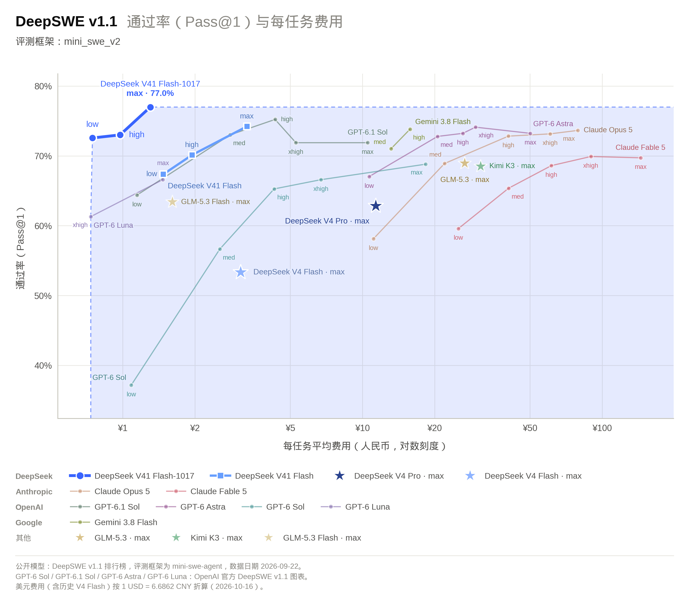
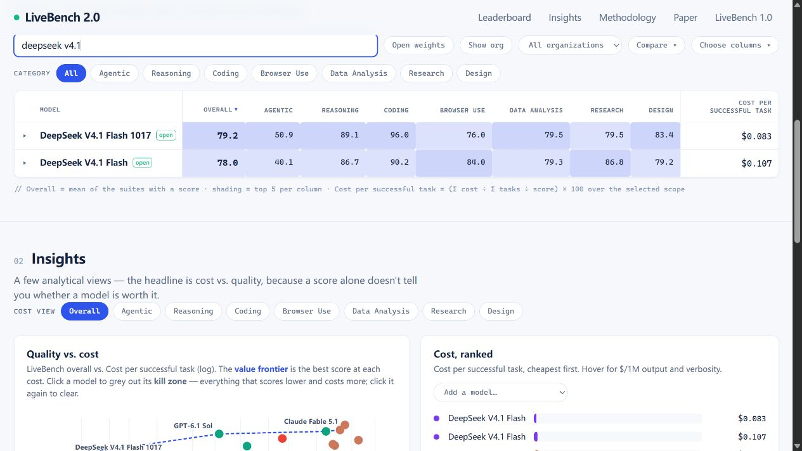

# DeepSeek V4.1 Flash 1017 更新：编程与 Agent 提升，搜索 API 正式开放

**更新日期 2026.10.18**

10 月 17 日，DeepSeek 将网页端、APP 和 API 同步更新到 **DeepSeek-V4.1-Flash-1017**。现有 API 用户仍然调用 `deepseek-flash`，模型 token 单价保持不变。

> 这次更新的三个重点：
>
> - 官方公布的 11 项基准成绩均高于 9 月版，重点涉及编程、智能体任务与视觉能力。
> - 官方强化了从零开发完整项目的能力，并称任务用时和输出长度下降；第三方与个人测试也出现改善，但不同任务的结果并不一致。
> - Search、Fetch 两种搜索工具接口开放，各为每千次成功请求 5 元。通过 DeepSeek API 在指定 Agent 工具中触发的服务端搜索与抓取，将于北京时间 **11 月 1 日 00:00** 开始计费。

## 一、完整项目开发能力继续加强

DeepSeek 在[官方模型卡](https://huggingface.co/deepseek-ai/DeepSeek-V4.1-Flash-1017)中将 1017 定义为 V4.1 Flash 的小版本更新，重点是让模型更好地完成项目。[官方发布公告](https://api-docs.deepseek.com/zh-cn/news/news261017/)介绍，它通过基于自反馈的强化学习，改善了游戏开发、3D 建模等从零构建项目的能力，并展示了故宫 3D 建模、网页版赛车、Godot 引擎《传送门2》复刻和时代演进 3D 场景等案例。

“许愿式编程”是官方对这类体验的描述：给出需求和少量参考，让模型在开发工具中把项目做出来。这些仍是官方展示的案例，不能据此保证任意项目都能一次交付。

与 9 月版相比，官方公布的 11 项基准成绩全部上升。几项与开发者关系较近的变化如下：

| Benchmark | 9 月版 V4.1 Flash | 1017 | 提升分数 |
| --- | ---: | ---: | ---: |
| Terminal-Bench 4.0 | 31.2 | 42.3 | +11.1 |
| DeepSWE v1.1 | 74.2 | 77.0 | +2.8 |
| ProgramBench | 20.3 | 29.1 | +8.8 |
| NL2Repo-Bench | 65.4 | 68.2 | +2.8 |
| Automation-Bench v1.0.6 | 54.8 | 60.5 | +5.7 |
| HLE，无工具 | 36.8 | 42.6 | +5.8 |

Terminal-Bench 关注模型在终端里执行任务，DeepSWE 关注软件工程任务，NL2Repo 则考察从自然语言需求到仓库级实现的能力。终端任务和 ProgramBench 的分数变化较大，DeepSWE 在原本较高的成绩上继续改善。

图片来源：[DeepSeek 官方发布页](https://api-docs.deepseek.com/zh-cn/news/news261017/)，厂商自测结果。

表中的 Terminal-Bench 4.0 使用 Claude Code 框架，DeepSWE 使用 Mini-SWE-V2。HLE 的 42.6 是整体成绩，纯文本子集为 44.0；图中的 ZeroBench-main 使用 Pass@5，即允许多次尝试的评测方式。

横向比较也要看具体项目：官方表中，1017 的 DeepSWE 77.0 高于 Claude Opus 5 的 74.0；但 Terminal-Bench 4.0、ProgramBench 和 NL2Repo 仍低于表中的 Opus 5。这份表比较的是列出的特定模型版本，不能延伸为超过所有最新旗舰。

## 二、任务成本更低，是在哪些条件下成立？

官方同时强调任务运行时间与输出长度下降，并用 DeepSWE 的通过率和任务均价展示改善。在这类多轮编码任务中，即使 token 单价不动，只要完成任务所需的推理、工具往返和输出减少，费用也可能下降。

图片来源：[DeepSeek 官方发布页](https://api-docs.deepseek.com/zh-cn/news/news261017/)，厂商给出的 DeepSWE v1.1 比较图。

图中横轴是人民币任务均价，采用对数刻度；同一模型的 low、high、max 也分别列点。图底说明，公开模型的部分基线取自 9 月 22 日榜单，OpenAI 模型点来自另一份官方表，因此它并非所有模型在同一天重新测试的结果。

独立测试已经提供了补充。**LiveBench 2.0** 在 10 月 18 日更新的榜单中，1017 综合分为 79.2，9 月版为 78.0。七个分项的变化并不相同：

| LiveBench 2.0 | 9 月版 | 1017 | 分差 |
| --- | ---: | ---: | ---: |
| 综合分 | 78.0 | 79.2 | +1.2 |
| Agentic，智能体任务 | 40.1 | 50.9 | +10.8 |
| Reasoning，推理 | 86.7 | 89.1 | +2.4 |
| Coding，编程 | 90.2 | 96.0 | +5.8 |
| Browser Use，浏览器操作 | 84.0 | 76.0 | -8.0 |
| Data Analysis，数据分析 | 79.3 | 79.5 | +0.2 |
| Research，研究 | 86.8 | 79.5 | -7.3 |
| Design，文档设计 | 79.2 | 83.4 | +4.2 |

图片来源：[LiveBench 2.0](https://livebench.ai/)，截图日期 2026 年 10 月 18 日。

这份结果支持编程与 Agent 任务改善，也显示浏览器操作、研究两项得分较低。按[榜单评测方法](https://livebench.ai/#/methodology)，每个模型每套任务只运行一次，分数还会受到工具与供应商故障影响，不能只凭这次结果就断言出现稳定退化。

该榜单全范围的“每成功任务成本”由约 0.75 元降到约 0.58 元，降幅约 22.4%。这里混合了编码、长程任务及大量简答题，与官方 DeepSWE 的任务均价无法统一换算。

## 三、社区实测：日常任务更稳，难题和长任务仍有边界

开发者 Ibragim Badertdinov 在[个人编码任务评测](https://ibragim.dev/leaderboard/)中公布了一组来自日常工作的 **10 个编码任务**，每题跑三次，用隐藏测试验收；[Reddit 原帖](https://www.reddit.com/r/LocalLLaMA/comments/1x8mq6f/deepseek_v41_flash_1017_vs_v41_flash_pi_vs/)补充了测试说明与讨论。相比只展示一张成品图，这组数据还列出了推理强度、费用、耗时和重复通过情况：

| 配置 | 30 次运行通过率 | 三次全过的题目比例 | 平均任务费用 | 平均耗时 |
| --- | ---: | ---: | ---: | ---: |
| Pi + 9 月版 max | 93.3% | 80% | 约 0.30 元 | 4 分 30 秒 |
| Pi + 1017 high | 100% | 100% | 约 0.32 元 | 2 分 38 秒 |
| Pi + 1017 low | 90% | 90% | 约 0.18 元 | 1 分 31 秒 |
| DeepSeek Harness + 1017 low | 96.7% | 90% | 约 0.23 元 | 1 分 53 秒 |

Pi 是这次测试使用的 Agent 框架；high、max 等表示推理强度。在这组配置中，新版 high 的 30 次运行全部通过，任务耗时比旧版 max 少约 41.5%，但平均费用高约 5.9%。累计 token 也从每任务约 42.6 万增至 54.7 万，缓存命中率则从 90.8% 提高到 97.9%。

**“任务更快”并不必然等于“token 更少、费用更低”。** 新旧配置的推理强度不同，题目也只有十道，多个模型已达到满分，适合参考日常小任务的表现，不能当作通用编程能力排名。累计 token 还包含反复传入的历史上下文，并非单次输出长度。

小项目方面，LINUX DO 有开发者使用 1017 与 DeepSeek Harness rc.2 制作[雨夜便利店 3D 场景](https://linux.do/t/topic/3038098)，自报约 20 分钟、2 元；V2EX 也有[用户反馈](https://v2ex.com/t/1249603)，约 40 分钟完成了 Compose Multiplatform 的原生 UI 迁移。这些是个人作品和体验，缺少统一条件，不能直接推广为平均效率。

失败报告也值得一起看。Reddit 有用户用[两道高难算法题测试](https://www.reddit.com/r/DeepSeek/comments/1x8hufq/some_testing_on_how_deepseekv41017_handle_hard/)，在多个推理档位下仍得到错误答案；LINUX DO 的一份 [SNSE Bench 算法测试](https://linux.do/t/topic/3037238)则出现遗漏题目规定的 `init` 函数、导致编译失败的情况。该测试作者明确说本轮未测 Pass@3，也就是多次尝试后的通过情况，结果只宜作为具体案例参考。

长时间无人值守还涉及工具编排。V2EX 一位开发者在[通宵开发记录](https://v2ex.com/t/1249671)中提到，模型运行约三小时、推进四个需求后，两个并行任务共用浏览器发生冲突，被框架拦截，最终等待人工处理。作者将问题归于自己的系统设计；这个例子提醒的是共享资源要协调，不能全部算成模型能力不足。

## 四、token 价格不变，搜索与抓取另行收费

1017 的官方模型调用名仍为 `deepseek-flash`，上下文长度 1M，最大输出 384K，支持图像理解。当前[官方定价页](https://api-docs.deepseek.com/zh-cn/quick_start/pricing/)仍单独提供 V4 Pro 0813，Pro 用户不要把此次 Flash 更新理解为自己的模型已经被统一替换。

Flash 的价格保持不变，单位为**元／百万 tokens**：

| 时段 | 输入，缓存命中 | 输入，缓存未命中 | 输出 |
| --- | ---: | ---: | ---: |
| 空闲 | 0.02 | 1 | 4 |
| 高峰 | 0.04 | 2 | 8 |

高峰为北京时间周一至周五 9:00–12:00、14:00–18:00，排除中国法定节假日；其余时段，包括周末与法定节假日全天，均按空闲价计算。

按[搜索与抓取指南](https://api-docs.deepseek.com/zh-cn/guides/search/)，此次开放的 Search 返回结构化网页搜索结果，Fetch 将单个网页抓取为 Markdown。两者是独立 API：

| 接口 | 计费单位 | 官方人民币价格 |
| --- | --- | ---: |
| Search | 每千次成功且有结果的请求 | 5 元 |
| Fetch | 每千次成功且返回正文的请求 | 5 元 |

失败、超时和搜索无结果不收费，Search 单次返回多少条结果也不改变单次价格。两种接口各有账号级 5 QPS，也就是每秒 5 次请求的限制。

假设一次任务成功搜索一次、再抓取五个网页，工具费是 **6 × 5 ÷ 1000 = 0.03 元**；一千组同样的调用为 30 元，模型 token 费另算。这是调用算例，不是实测平均任务价。

[官方公告](https://api-docs.deepseek.com/zh-cn/news/news261017/)还明确了计费时间点：通过 DeepSeek API 在 **DeepSeek Harness、Claude Code、Codex** 中使用的服务端 Search/Fetch 工具调用，目前未计费，将于北京时间 **2026 年 11 月 1 日 00:00** 起按次收费。这段免费过渡针对公告所述调用路径，不能理解为所有直接搜索 API 请求在此之前都免费，也不适用于推断其他厂商的收费规则。

## 五、在现有工作中怎么用

**继续用官方 API 做日常编码**，仍选择 `deepseek-flash` 即可。[官方建议](https://api-docs.deepseek.com/zh-cn/news/news261017/)将 DeepSeek Harness 升到 **0.2.1-rc.1 及以上**，以获得新版适配；模型[思考模式](https://api-docs.deepseek.com/zh-cn/guides/thinking_mode/)默认开启，默认强度为 high。可以先用日常改动比较结果，复杂任务再评估 max 的收益与耗时。

**尝试完整项目和交互原型**，可以把需求拆成可验收的功能，让模型逐步构建、运行和检查。官方案例与部分社区作品提供了值得试用的理由，但视觉效果好，仍不等于功能、边界条件和维护性都已过关。

**处理高难算法、关键代码或长时间无人值守维护**，继续保留测试和人工验收；并行开发还要协调浏览器等共享资源。1017 的进步足以让现有 Flash 用户重新试一轮自己的任务，也值得关注它在更大规模独立评测中的表现。

[模型权重](https://huggingface.co/deepseek-ai/DeepSeek-V4.1-Flash-1017)已按 MIT 许可开放。需要接入官方服务，可从 [DeepSeek API 按量入口](https://api.dreamfree.space/c/s/cpyqdeepseek/20261017_deepseek_v4_1_flash_1017) 进入。

费用折合人民币的第三方数据按 1 美元约 7 元估算；官方人民币价格直接采用原价。

主要资料：[DeepSeek 更新日志](https://api-docs.deepseek.com/zh-cn/updates/)、[官方模型卡](https://huggingface.co/deepseek-ai/DeepSeek-V4.1-Flash-1017)、[模型与价格](https://api-docs.deepseek.com/zh-cn/quick_start/pricing/)、[搜索与抓取指南](https://api-docs.deepseek.com/zh-cn/guides/search/)、[LiveBench 2.0](https://livebench.ai/)、[个人编码任务评测](https://ibragim.dev/leaderboard/)。
