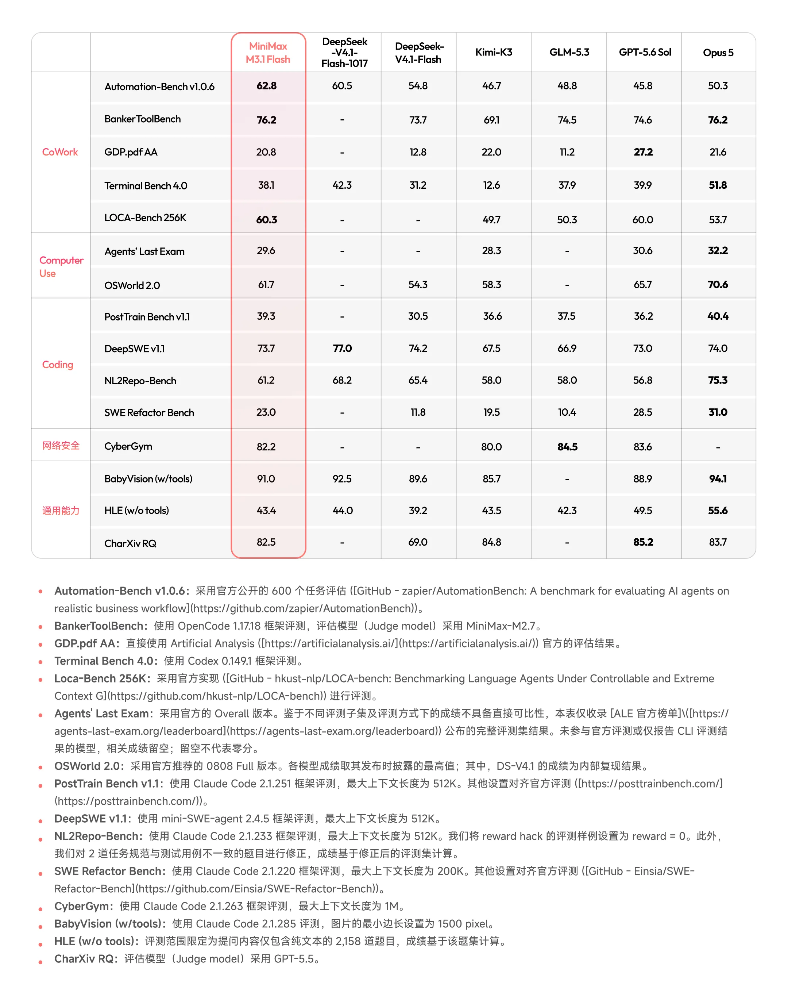
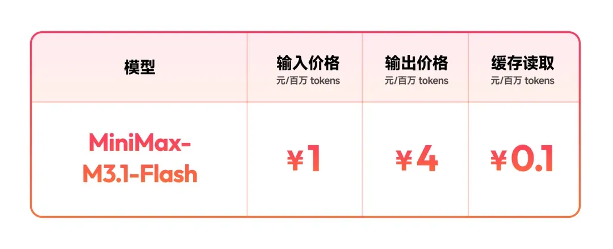
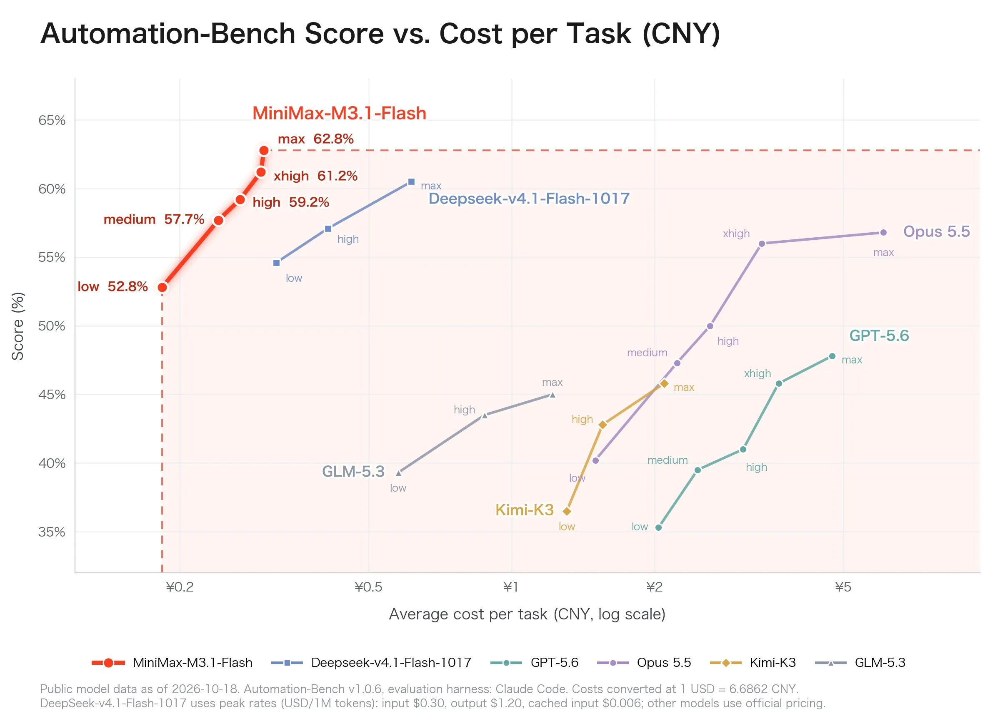

# MiniMax M3.1 Flash 正式发布：Space Bunny 揭晓，编程与 Agent 升级

**更新日期 2026.10.20**

10 月 19 日，MiniMax 正式发布 **M3.1 Flash**，并确认匿名模型 **Space Bunny** 是它的早期版本。模型已上线 MiniMax API、M Plan 和 MiniMax Code；[官方公告](https://www.minimax.cn/blog/minimax-m31f)称权重将稍后开放，Pro 版本也会随后推出。

> 这次更新的三个重点：
>
> - 加强跨应用自动化、软件工程与电脑操作能力，保留 1M 上下文和多模态输入。
> - 国内 API 每百万 token 输入 1 元、输出 4 元、缓存读取 0.1 元；官方称 Agent 任务综合成本较前代下降 70%。
> - Preview 旧名称已转向正式版；M2.5、M2.7 的订阅调用与按量付费调用，采用不同迁移安排。

## 一、自动化任务突出，编程成绩各有高低

M3.1 Flash 支持 **100 万 token 上下文**，可接收文字、图片和视频，输出文字。代码与界面截图可以一起交给模型处理；生成视频则属于 H3 等独立模型的能力。[模型调用文档](https://platform.minimax.io/docs/guides/text-generation)还提供了可调思考深度，方便在任务质量、等待时间与消耗之间选择。

MiniMax 此次重点强调 Agentic capabilities（智能体能力）：模型需要规划步骤、调用工具，在真实软件环境中持续执行。对于开发者，这包括读懂已有代码、修改功能、运行测试；对于办公自动化，则包括跨多个业务系统处理任务。

在 MiniMax 公布的对照表中，M3.1 Flash 的 **Automation-Bench v1.0.6 为 62.8**，高于 DeepSeek V4.1 Flash 1017 的 60.5。但在软件工程、终端任务和从需求构建代码仓库的测试中，DeepSeek 1017 的分数更高。

| 基准 | M3.1 Flash | DeepSeek V4.1 Flash 1017 | 主要考察内容 |
| --- | ---: | ---: | --- |
| Automation-Bench v1.0.6 | **62.8** | 60.5 | 跨业务系统自动化，公开 600 个任务 |
| DeepSWE v1.1 | 73.7 | **77.0** | 长流程软件工程，Pass@1 |
| Terminal Bench 4.0 | 38.1 | **42.3** | 终端环境中的任务执行 |
| NL2Repo-Bench | 61.2 | **68.2** | 从自然语言需求构建代码仓库 |
| OSWorld 2.0 | 61.7 | — | 图形界面与跨应用电脑操作 |
| Agents' Last Exam（ALE） | 29.6 | — | 真实专业工作流，Overall 完整评测集 |

来源：[MiniMax 官方发布对照表](https://www.minimax.cn/blog/minimax-m31f)。各项采用不同评测框架或结果来源；例如 DeepSWE 使用 mini-SWE-agent，终端测试使用 Codex，NL2Repo 使用 Claude Code。表中“—”表示未提供对应结果。

图片来源：[MiniMax 官方发布页](https://www.minimax.cn/blog/minimax-m31f)。完整表含各项框架与测试集说明；其中 HLE 为不使用工具的 2,158 道纯文本题子集。

完整表还列出 **BankerToolBench 76.2**、**CyberGym 82.2**，分别涉及复杂金融工具任务和漏洞发现、验证。M3.1 Flash 的优势覆盖多个实际工作场景，但选型仍应落到具体任务：自动化流程、代码修改和电脑操作，不能只用其中一项成绩代替全部能力。

## 二、独立结果已出现，社区体验要分版本看

[Artificial Analysis（AA）](https://artificialanalysis.ai/models/minimax-m3-1-flash)已给出 M3.1 Flash 的 **Intelligence Index 42 分**。这个分数放在其他模型旁边更容易理解：截至 **10 月 20 日**，以下模型页采用的都是 **Intelligence Index v4.3.2**，分数越高表示该综合评测中的表现越好。

| 模型（链接为 AA 原始模型页） | AA Intelligence Index |
| --- | ---: |
| [DeepSeek V4.1 Flash 1017（Max）](https://artificialanalysis.ai/models/deepseek-v4-1-flash-1017) | 45 |
| [**MiniMax M3.1 Flash**](https://artificialanalysis.ai/models/minimax-m3-1-flash) | **42** |
| [GLM-5.3-Flash](https://artificialanalysis.ai/models/glm-5-3-flash) | 42 |
| [MiniMax M3](https://artificialanalysis.ai/models/minimax-m3) | 29 |

按页面展示的整数分数，**M3.1 Flash 比 M3 高 13 分，与 GLM-5.3-Flash 同分，比 DeepSeek 1017（Max）低 3 分**。这是综合指数的分差，不代表正确率或能力提升的百分比，也不能直接推断某个编程任务的胜负。AA 的测试组合与 MiniMax 发布表不同，两者分数不能直接互换。

AA 模型页还给出了 **125.5 token/秒**的输出速度；不同测试条件下的速度不宜直接与厂商公布值对比。

社区已经积累了一批作品和使用记录，其中不少来自正式发布前的 Preview 或 Space Bunny。

**小游戏和交互页面有正向反馈。** V2EX 用户 [22too 在 9 月 29 日的帖子](https://www.v2ex.com/t/1245637)中，分享了用 M3.1-Flash-Preview 制作的塔防、重力与化学实验、初中生物图解等页面。他表示多数需求可以通过简短描述推进，部分场景仍需截图反馈 bug。这是作者的作品分享，适合参考原型制作体验，不能据此保证一句话完成任意项目。

**复杂任务需要给思考和答案都留出预算。** JP Caparas 在 [9 月 27 日的个人 Preview 评测](https://ai.sulat.com/minimax-m3-1-flash-preview-tested-outside-minimax-code-88660262a51e)中，通过 OpenCode 接入模型，观察到小范围分页修复较快，但复杂异步缓存任务曾耗尽 16,384 token 的输出预算，没有交付代码。这是早期版本在特定预算下的自报结果，不能据此断言正式版仍有相同问题。

发布当天也出现了具体失败反馈：Reddit 用户 [AppealSame4367](https://www.reddit.com/r/LocalLLaMA/comments/1x9uzv9/comment/phpl8a2/)自报，模型改坏了其 3D 游戏中的路径，两轮后仍未修复。帖子没有完整框架、思考强度和模型版本记录，只能作为单例。Linux DO 用户 [Shiroby 的反馈](https://linux.do/t/topic/3044513/8)则侧重 CLI 与 MCP 集成体验，不能全部归为模型本身的能力问题。

这些记录支持先试小范围修改、保留测试与回滚点。正式版的真实项目完成率，还需要在自己的代码库、工具和验收标准下判断。

## 三、输入 1 元、输出 4 元，总成本还看思考与缓存

[MiniMax 国内定价页](https://platform.minimax.cn/docs/pricing/overview)与 [DeepSeek 官方定价页](https://api-docs.deepseek.com/zh-cn/quick_start/pricing/)给出的价格如下，单位均为**元 / 百万 token**。DeepSeek V4.1 Flash 当前对应 1017 版本。

| 模型与服务档位 | 未缓存输入 | 输出 | 缓存读取 |
| --- | ---: | ---: | ---: |
| M3.1 Flash | **1.00** | **4.00** | **0.10** |
| M3 标准服务，单次输入不超过 512K | 2.10 | 8.40 | 0.42 |
| M3 标准服务，单次输入超过 512K | 4.20 | 16.80 | 0.84 |
| DeepSeek V4.1 Flash，空闲时段 | 1.00 | 4.00 | 0.02 |
| DeepSeek V4.1 Flash，高峰时段 | 2.00 | 8.00 | 0.04 |

M3 仅列当前标准服务价格。DeepSeek 高峰时段为北京时间周一至周五的 9:00–12:00、14:00–18:00，不含中国法定节假日；其余时间，包括周末和法定节假日全天，均为空闲时段。

**M3.1 Flash 比 M3 两档标准价都低；与 DeepSeek 空闲价相比，未缓存输入和输出持平，缓存读取价格为其 5 倍。** 与 DeepSeek 高峰价相比，M3.1 Flash 的未缓存输入和输出便宜一半，但缓存读取仍更贵。高缓存命中率的 Agent 工作流，需要把缓存价格一起算进去。

官方所说的 **Agent 任务综合成本下降 70%**，包含任务执行中的实际消耗，不能直接理解为每一项 token 单价都降低 70%。

图片来源：[MiniMax 官方发布页](https://www.minimax.cn/blog/minimax-m31f)。人民币官方标价，单位为元 / 百万 token。

缓存会明显影响账单。假设一组调用累计输入 **1 亿 token**，其中 **96% 命中缓存**，即 9600 万命中、400 万未命中；输出量为输入的 **0.3%**，即 **30 万 token**。按每百万 token 的单价计算，模型 token 费用为：

**96 × 0.1 + 4 × 1 + 0.3 × 4 = 14.80 元。**

同样的输入与输出，如果没有缓存命中，费用为 **101.20 元**。这是假设算例，输出量按含思考在内的计费 token 统计；实际需以缓存命中情况和计费用量为准，工具等额外费用未计入。

将相同的计费 token 用量代入各档位单价，费用如下：

| 模型与计费档位 | 这组用量的 token 费用 |
| --- | ---: |
| M3.1 Flash | **14.80 元** |
| M3 标准服务，单次输入不超过 512K | 51.24 元 |
| M3 标准服务，单次输入超过 512K | 102.48 元 |
| DeepSeek V4.1 Flash，空闲时段 | **7.12 元** |
| DeepSeek V4.1 Flash，高峰时段 | 14.24 元 |

这里的 1 亿 token 是多次调用的累计输入，分别假设所有请求都按对应长度档位或时段计费。固定用量下，M3.1 Flash 比 M3 更省，与 DeepSeek 高峰费用接近，而 DeepSeek 空闲费用更低；同一真实任务在不同模型上的 token 消耗和缓存命中率仍可能不同。

MiniMax 同时公布了 Automation-Bench 的分数与单任务成本曲线：M3.1 Flash 从 low 到 max 的成绩由 **52.8% 提升至 62.8%**，思考强度提高也增加了消耗。

图片来源：[MiniMax 官方发布页](https://www.minimax.cn/blog/minimax-m31f)。官方评测采用 Automation-Bench v1.0.6 与 Claude Code；横轴为单任务平均成本、对数刻度。图中 DeepSeek 1017 使用厂商图注所列的高峰报价，其中缓存单价与当前人民币价表不同，不能直接用于估算当前各时段的账单。

速度方面，[官方公告](https://www.minimax.cn/blog/minimax-m31f)称输出中位数（P50）达到 **170+ token/秒**，日常场景可达 **200+ token/秒**。这是厂商披露的线上输出速度；任务还包含思考、工具运行、检查和返修，输出快不等于整个项目按同样比例更快交付。

## 四、旧模型名保留，实际调用可能已经改变

已经使用 MiniMax 的用户，需要区分订阅调用与按量付费调用。[官方迁移公告](https://platform.minimax.cn/docs/faq/models)和 [M Plan 模型说明](https://platform.minimax.cn/docs/m-plan/intro)列出了以下安排：

| 用户或模型名称 | 当前安排 |
| --- | --- |
| `MiniMax-M3.1-Flash-Preview` | 旧名称请求由 `MiniMax-M3.1-Flash` 提供服务 |
| M Plan、Token Plan 调用 M2.5 / M2.7 系列 | 10 月 19 日起统一路由至 M3.1 Flash，原模型名作为兼容入口保留 |
| 按量付费 API 的 M2.5 / M2.7 存量用户 | 可继续调用至 11 月 18 日正式下线，需提前迁移 |
| 希望新接入 M2.5 / M2.7 的用户 | 10 月 19 日起不再开放旧模型调用 |

官方称上述订阅路由不影响原有套餐用量权益。不过，模型名不变，实际服务的模型已经变化，已有提示词、思考设置和关键任务仍值得重新跑一次验收。

**旧 Token Plan 用户也不必仅为使用新模型就立即升级套餐。** [老用户安排](https://platform.minimax.cn/docs/m-plan/token-plan-notice)说明，已购 Token Plan 后续仍可使用最新模型；主动升级 M Plan 后无法切回，历史优惠和额外权益将不再保留。继续保留旧订阅则有自动续费、购买渠道等条件，操作前应核对自己适用的条款。

## 五、从现有任务开始试，先核对模型和思考强度

新配置可使用正式模型名 `MiniMax-M3.1-Flash`。根据[官方调用文档](https://platform.minimax.io/docs/guides/text-generation)，思考强度有 `low`、`medium`、`high`、`xhigh`、`max` 五档，**默认 max，思考不能关闭**。简单修改可以比较较低档位的耗时与结果，复杂任务再提高强度，同时给最终答案留足输出预算。

已有订阅可以直接在 MiniMax Code 中试用，或通过订阅 Key 接入熟悉的工具；[M Plan 用量说明](https://platform.minimax.cn/docs/m-plan/usage-rules)指出，这些入口消耗同一份额度，订阅 Key 与按量付费 Key 需要区分。

希望先试几道题，也可以查看 [OpenRouter 的 free 型号](https://openrouter.ai/minimax/minimax-m3.1-flash:free)。[Vercel AI Gateway 的公告](https://vercel.com/changelog/minimax-m3-1-flash-now-available-on-ai-gateway-for-free)称限时免费至 10 月 22 日，但需要由 MiniMax 承接请求，不能把其他路由一概视为免费。

M3.1 Flash 值得加入日常代码修改、带截图的前端任务和跨应用自动化的候选列表。已有稳定工作流，可以先拿几项真实任务比较完成质量、总耗时和总消耗，再决定是否调整主力模型。

[MiniMax 订阅入口](https://api.dreamfree.space/c/s/cpyqminimax/20261020_minimax_m3_1_flash) · [DeepSeek API 按量入口](https://api.dreamfree.space/c/s/cpyqdeepseek/20261020_minimax_m3_1_flash) · [智谱 GLM 入口](https://api.dreamfree.space/c/s/cpyqzhipu/20261020_minimax_m3_1_flash) · [OpenRouter 入口](https://api.dreamfree.space/c/s/cpyqopenrouter/20261020_minimax_m3_1_flash)
