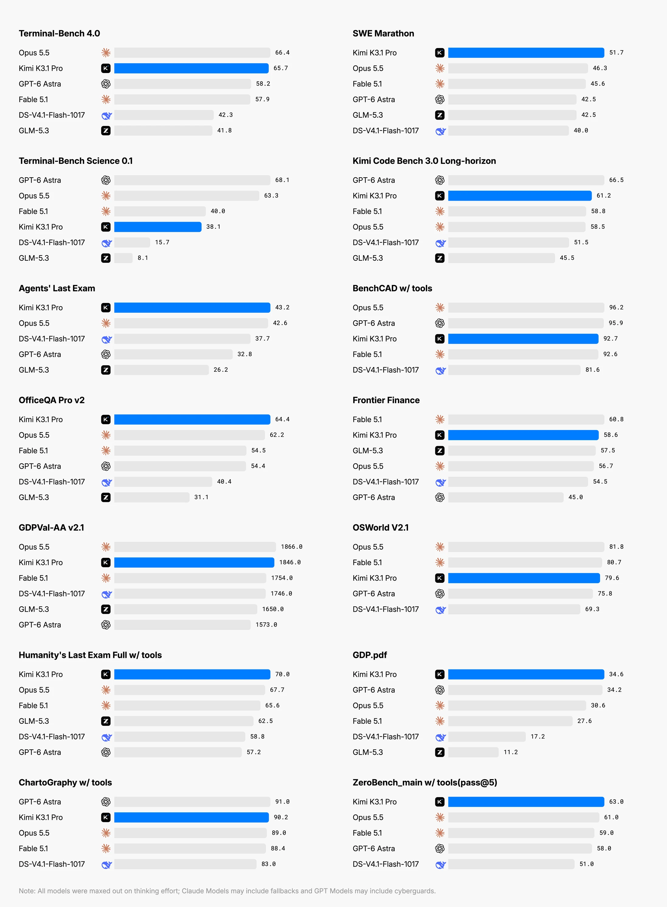
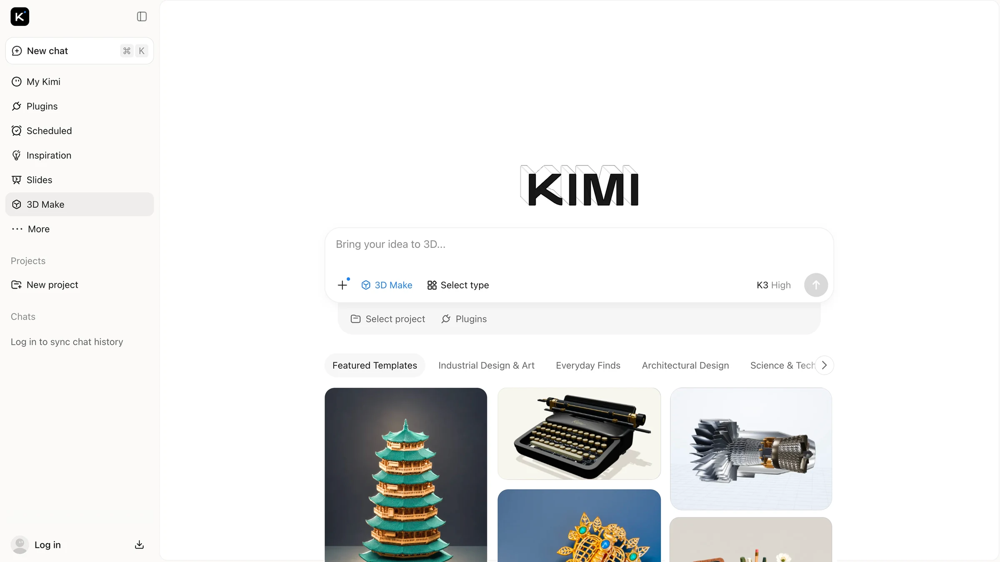
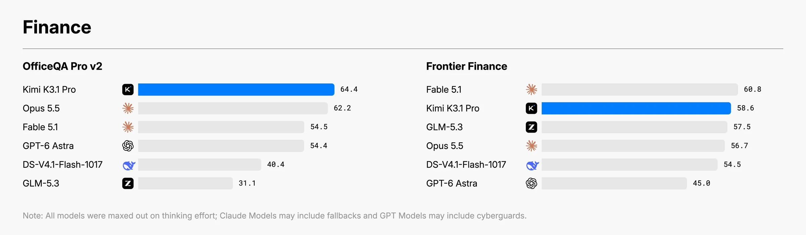

# Kimi K3.1 Pro 正式发布：编程与 3D 能力升级，Highspeed 同步上线

**更新日期 2026.10.24**

10 月 24 日，Kimi 正式推出 **K3.1 Pro**，同步上线 **K3.1 Pro Highspeed**。这是 K3.1 系列的首个模型，定位为 3 万亿级参数旗舰，支持 100 万 token 上下文；Kimi 网页、App、Kimi Work、Kimi Code 和 API 均已提供入口。[官方公告](https://www.kimi.com/en/blog/kimi-k3-1-pro)表示，完整模型权重计划在 **2026 年 11 月 4 日前**发布。

> 这次更新的重点：
>
> - 加强长程编程、3D 建模和金融文档工作流，继续支持百万 token 上下文。
> - Highspeed 据官方介绍保持同等能力，输出速度约为普通版的 2–3 倍。
> - 普通版人民币 API 单价低于 K3；高速版的输入、输出更贵，但缓存命中单价与普通版相同。
> - Kimi Code 普通版从 Plus / Moderato 起可用，完整 1M 上下文与高速版需要更高档位。

## 一、长程编程升级，科学任务仍有差距

K3.1 Pro 是 **K3 的后训练升级版本**。官方增加了强化学习投入，覆盖数百个下游领域，并优化长上下文推理、沙箱环境和训练调度。重点包括让模型在读代码、调用工具、执行测试与修复问题之间持续推进。

在 Kimi 公布的编程成绩中，普通终端任务与更偏科学研究的终端任务呈现出不同表现：

| 基准 | K3.1 Pro | Claude Opus 5.5 | GPT-6 Astra |
| --- | ---: | ---: | ---: |
| Terminal-Bench 4.0 | **65.7%** | 66.4% | 58.2% |
| Terminal-Bench Science 0.1 | **38.1%** | 63.3% | 68.1% |

来源：[Kimi 官方基准总览及脚注](https://www.kimi.com/en/blog/kimi-k3-1-pro)。Kimi 在这两项中使用 Claude Code 执行框架；普通 Terminal-Bench 的其他模型成绩取自各自公告或官方榜单的较高值，Science 的其他成绩来自对应榜单。它们是厂商汇总结果，不能视为全部模型在同一环境中的独立复测。

**K3.1 Pro 在 Terminal-Bench 4.0 接近 Opus 5.5，但在 Science 0.1 上仍有明显差距。** 真实选型需要区分日常工程任务、科学计算和复杂研究，不能用一项领先概括全部编程能力。

在 Kimi 自研的 **Code Bench 3.0 Long-horizon** 中，K3.1 Pro 为 **61.2%**，K3 为 **55.95%**。这项测试侧重多步执行、工具调用和端到端工程任务；内部成绩适合观察厂商报告的代际变化。

图片来源：[Kimi 官方发布页](https://www.kimi.com/en/blog/kimi-k3-1-pro)。图中各模型按最高思考强度比较，具体执行框架、成绩引用来源及回退等说明见原文脚注。

## 二、独立评测：AA 与 LiveBench 的表现

### AA：综合指数 55 分

截至 **10 月 24 日**，Artificial Analysis（AA）已给出 K3.1 Pro 的独立结果。以下八个模型页面均采用 **Intelligence Index v4.3.2**，按页面展示的整数分数排列：

| 模型（AA 测试配置） | AA Intelligence Index |
| --- | ---: |
| Claude Opus 5.5（Max，默认回退） | 58 |
| **Kimi K3.1 Pro** | **55** |
| Claude Fable 5.1（Max，默认回退） | 53 |
| GPT-6 Astra（Max） | 53 |
| GPT-6.1 Sol（Max） | 52 |
| DeepSeek V4.1 Flash 1017（Max） | 45 |
| Kimi K3（Max） | 44 |
| MiniMax M3.1 Flash | 43 |

来源：[AA：Kimi K3.1 Pro](https://artificialanalysis.ai/models/kimi-k3-1-pro)、[Kimi K3](https://artificialanalysis.ai/models/kimi-k3)、[Opus 5.5](https://artificialanalysis.ai/models/claude-opus-5-5)、[Fable 5.1](https://artificialanalysis.ai/models/claude-fable-5-1)、[GPT-6 Astra](https://artificialanalysis.ai/models/gpt-6-astra)、[GPT-6.1 Sol](https://artificialanalysis.ai/models/gpt-6-1-sol)、[DeepSeek 1017](https://artificialanalysis.ai/models/deepseek-v4-1-flash-1017)、[MiniMax M3.1 Flash](https://artificialanalysis.ai/models/minimax-m3-1-flash)。两款 Claude 保留 AA 标注的 Default Fallback（默认回退）测试条件；不同思考档位或回退设置的结果不能直接替换。

**K3.1 Pro 比 K3（Max）高 11 分，与 Opus 5.5（Max，默认回退）相差 3 分**；比 Fable 5.1 和 GPT-6 Astra 的上述配置各高 2 分，比 GPT-6.1 Sol（Max）高 3 分。它也比 DeepSeek 1017（Max）、MiniMax M3.1 Flash 分别高 10 分和 12 分。这个指数混合了知识工作、终端任务、推理、长上下文等评测，**55 分不是 55% 正确率，分差也不能直接换算为能力提升百分比**。

AA 页面测得普通版输出速度为 **77.1 token/秒**。这为等待时间提供了一个外部参照，但不代表自己的请求一定达到该速度，也不能将它直接乘以官方倍率，作为 Highspeed 的独立测速结果。

### LiveBench 2.0：总分 76.7，编程较 K3 提升

[LiveBench 2.0](https://livebench.ai/#/)覆盖长程 Agent、编程、浏览器操作、研究、文档设计，以及短题形式的推理和数据分析。以下采用 **2026 年 10 月 14 日发布的评测版本**，榜单标注最近更新为 **10 月 23 日**，列出同一组八个模型的总分与四个分项：

| 模型 | 总分 | Agentic（长程任务） | Reasoning（推理） | Coding（编程） | Research（研究） |
| --- | ---: | ---: | ---: | ---: | ---: |
| Claude Fable 5.1 | 88.0 | 80.8 | 91.7 | 97.7 | 82.0 |
| Claude Opus 5.5 | 86.5 | 85.0 | 92.2 | 96.3 | 85.0 |
| GPT-6 Astra | 86.1 | 82.4 | 92.7 | 93.7 | 85.2 |
| GPT-6.1 Sol | 85.4 | 73.0 | 92.6 | 96.0 | 83.5 |
| DeepSeek V4.1 Flash 1017 | 79.2 | 50.9 | 89.1 | 96.0 | 79.5 |
| **Kimi K3.1 Pro** | **76.7** | **49.5** | **91.1** | **81.8** | **77.9** |
| MiniMax M3.1 Flash | 73.1 | 34.7 | 82.9 | 83.9 | 72.7 |
| Kimi K3 | 63.4 | 42.8 | 90.7 | 59.3 | 79.0 |

来源：[LiveBench 原站榜单](https://livebench.ai/#/)，读取日期为 10 月 24 日；表中模型的展开行均标注 `max`。总分按该版本七套任务等权平均，表内仅展示四个分项，不能用这四列重新计算总分；其数值与 AA 指数也不能互换。

**K3.1 Pro 比 K3 的总分高 13.3 分，Coding 高 22.5 分，Agentic 高 6.7 分；Research 则低 1.1 分。** 在这组任务中，K3.1 Pro 的总分、Coding 和 Agentic 都低于 DeepSeek 1017，也低于表中的两款 Claude 和两款 GPT。AA 与 LiveBench 的相对表现不同，综合能力和具体工作流需要分别看。

按[评测方法](https://livebench.ai/#/methodology)，LiveBench 每个模型每套任务只运行一次，其中 Agentic 为 18 个任务、Coding 为 29 个任务；工具或供应商故障在一次重试后仍无法测量的任务也计零分。单次结果有波动，不能仅凭某个分项下降就断言出现稳定退化。

## 三、3D Make 上线，金融工作流也有提升

3D 是这次更新比较直观的应用方向。按照[官方模型介绍](https://platform.kimi.com/docs/guide/kimi-k3-1-pro-quickstart)，模型可以通过编写和运行 Blender、CAD 等工具的脚本，处理几何、材质和场景，再将资产接入网页或游戏引擎。

在 Kimi 公布的 **BenchCAD 使用工具测试**中，K3.1 Pro 得分 **92.7%**。该测试通过生成 CAD 代码重建多视角图像中的物体，考察空间理解与建模；成绩对应官方抽取的 1,000 个样本及特定工具框架，不能直接当作任意工业设计任务的成功率。

Kimi 网页和 App 同步提供 **3D Make**：支持在线预览、编辑模型，并下载用于 3D 打印，或导出视频、实况照片。做交互原型、小游戏和产品展示时，可以先从一个可验收的小资产开始。

图片来源：[Kimi 官方发布页](https://www.kimi.com/en/blog/kimi-k3-1-pro)。此图展示 3D Make 功能与模板；界面中的模型标签沿用官方示意，不代表当前会话已选择 K3.1 Pro。

金融场景主要涉及文档检索、跨文件核对、多步计算与表格工作。在官方公布的结果中，**OfficeQA Pro v2 为 64.4，Frontier Finance 为 58.6**。两项分别侧重财务文档分析和完整投资工作流，成绩也说明优势会随任务变化：K3.1 Pro 在这张 OfficeQA 对照图中最高，Frontier Finance 则低于 Fable 5.1。

图片来源：[Kimi 官方发布页](https://www.kimi.com/en/blog/kimi-k3-1-pro)。厂商公布的成绩与比较条件，不等同于实际投资收益或日常任务保证。

## 四、普通版比 K3 便宜，高速版并非每一项都翻倍

[Kimi 人民币定价页](https://platform.kimi.com/docs/pricing/chat)与[开放平台首页](https://platform.kimi.com/)列出的价格如下，单位均为 **元 / 百万 token**：

| 模型 | 未缓存输入 | 输出 | 缓存命中 | 缓存写入 5 分钟 | 缓存写入 1 小时 |
| --- | ---: | ---: | ---: | ---: | ---: |
| K3.1 Pro | **13** | **68** | **1.3** | **13** | **26** |
| K3.1 Pro Highspeed | 26 | 136 | **1.3** | 26 | 52 |
| K3 | 20 | 100 | 2 | 20 | 40 |

普通版相对 K3，未缓存输入、缓存读取和写入单价下降 **35%**，输出单价下降 **32%**。模型完成同一任务时可能产生不同的思考和工具调用量，因此这不是实际任务费用的固定降幅。

Highspeed 的未缓存输入、输出和写入价格均为普通版的两倍，但**缓存命中仍为 1.3 元**。高缓存命中率的长会话，最终价差会明显小于两倍。

例如，多次调用累计输入 **1 亿 token**，其中 **96% 命中缓存**，计费输出为 **30 万 token**。其余 **400 万输入**按未缓存或默认 5 分钟写入计费，两类单价相同；不包含 1 小时写入及工具等其他费用。普通版费用为：

**96 × 1.3 + 4 × 13 + 0.3 × 68 = 197.20 元。**

相同计费用量下，Highspeed 为 **269.60 元**，约贵 **36.7%**；K3 为 **302.00 元**。这是假设用量算例，输入是多次调用的累计值，输出需包含实际计费的思考 token，不能据此保证同一真实任务的费用。

[缓存文档](https://platform.kimi.com/docs/guide/context-caching)说明，缓存读取、写入与未缓存输入的 token 分类互斥，**同一批写入 token 不再重复加收一遍未缓存输入费**。默认缓存有效期为 5 分钟，命中可免费续期；选择 1 小时档则按更高的写入单价计费。连续执行的 Agent 与隔一段时间再追问的会话，需要分别考虑。

## 五、Kimi Code 怎么用：会员门槛与模型 ID 要分清

[Kimi Code 模型配置](https://www.kimi.com/code/docs/kimi-code/models.html)给出的权限如下：

| 能力 | 新套餐 | 老套餐 |
| --- | --- | --- |
| K3.1 Pro 普通版 | Plus 及以上 | Moderato 及以上 |
| 普通版最高 1M 上下文 | Pro 及以上 | Allegretto 及以上 |
| K3.1 Pro Highspeed | Pro 及以上 | Allegretto 及以上 |

能选普通版，不等于当前套餐已经解锁完整百万上下文。Code 文档还注明，高速版的消耗约为普通版两倍；这是 **Coding Plan 的消耗说明**，与按量 API 的分项价格分别计算，不能互相套用。

已有 Code 权限时，建议**新建会话**，在官方 CLI 输入 `/model` 切换；列表尚未更新时，可按官方指引退出后重新登录。第三方工具应填写正确的模型 ID：

- **Kimi Code**：`k3.1-pro`、`k3.1-pro-highspeed`。
- **按量 Kimi API**：`kimi-k3.1-pro`、`kimi-k3.1-pro-highspeed`。

两种入口使用各自的 Key、地址和计费方式。Code 文档提示，填错模型 ID 可能兜底到旧模型，因此只修改界面显示名称还不够。

K3.1 Pro 系列**仅支持思考模式**，提供 `low`、`high`、`max` 三档，默认 `max`；关闭思考会被拒绝。简单修改可以先降低思考强度，复杂任务则应给推理和最终答案都留足预算。

按量 API 还有独立的访问条件：[官方指南](https://platform.kimi.com/docs/guide/kimi-k3-1-pro-quickstart)要求先充值解锁，最低充值 **10 元**；新用户注册认证赠送的 **15 元代金券不能用于 K3.1 Pro**。已有 Kimi 会员也不应默认按量 API 会从会员额度中扣除。

## 六、总结

Kimi K3.1 Pro 的升级重点是长程编程、3D 创作和金融工作流。AA 综合指数达到 **55 分**，比 K3（Max）高 11 分，与 Opus 5.5（Max，默认回退）相差 3 分；在科学任务等单项上仍有差距，实际表现需要结合具体场景判断。

普通版 API 单价低于 K3，Highspeed 则提供官方所称的约 **2–3 倍输出速度**，两者缓存命中单价相同。在线产品与 API 已上线，Kimi Code 的模型和上下文权限按会员档位开放；完整模型权重计划在 **11 月 4 日前**发布。

体验入口（推广）：[Kimi / Kimi Code](https://api.dreamfree.space/c/s/cpyqkimi/20261024_kimi_k3_1_pro)。对照模型入口：[DeepSeek API](https://api.dreamfree.space/c/s/cpyqdeepseek/20261024_kimi_k3_1_pro)、[MiniMax](https://api.dreamfree.space/c/s/cpyqminimax/20261024_kimi_k3_1_pro)。
