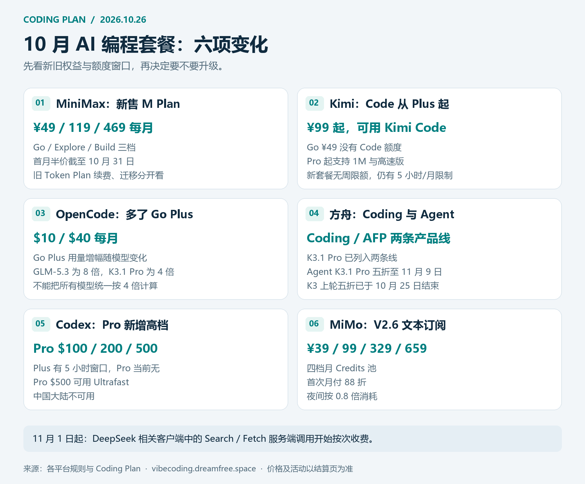
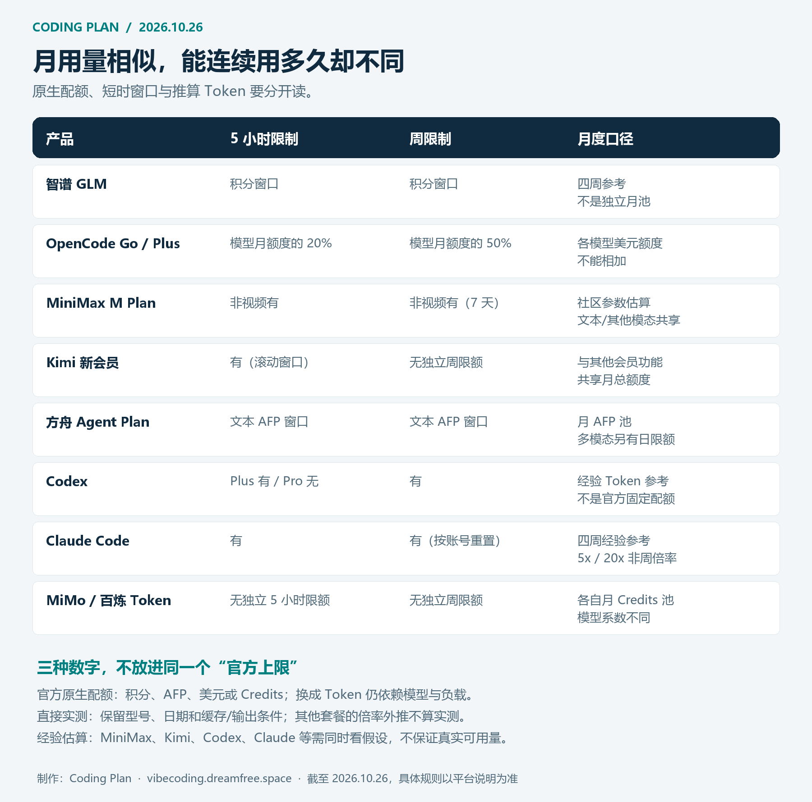

# 2026年10月 AI Coding Plan 与 API 平台对比：MiniMax M Plan、Kimi新会员、OpenCode Go Plus怎么选

**更新日期：2026年10月26日**  
数据与持续更新：[https://vibecoding.dreamfree.space](https://vibecoding.dreamfree.space)

**本期变化**

- [MiniMax](https://api.dreamfree.space/c/s/cpyqminimax/20261026) 新售套餐切换为 M Plan，Go、Explore、Build 常规月价仍为49、119、469元；首月半价截至10月31日，旧 Token Plan 的续费与升级规则分开计算。
- [Kimi](https://api.dreamfree.space/c/s/cpyqkimi/20261026) 已有新的公开订阅入口。Go、Plus、Pro、Max、Ultra 五档中，**Plus起才有 Kimi Code**；新会员取消周限额，仍保留五小时窗口与共享月额度。
- [OpenCode](https://api.dreamfree.space/c/s/cpyqopencode/20261026) 增加每月40美元的 Go Plus。相对10美元 Go，GLM-5.3月额度增至8倍、K3.1 Pro增至4倍、MiMo Flash与DeepSeek Flash增至2倍，不能统一按四倍理解。
- [字节方舟](https://api.dreamfree.space/c/s/cpyqfangzhou/20261026) 的 Coding Plan 与 [Agent Plan](https://api.dreamfree.space/c/s/cpyqfangzhout/20261026) 分别提供订阅入口，K3.1 Pro已列入支持范围；K3上一轮五折在10月25日结束，新模型活动需按各自期限计算。
- [Codex](https://api.dreamfree.space/c/s/cpyqchatgpt/20261026) 已列出100、200、500美元三档 Pro；[小米MiMo](https://api.dreamfree.space/c/s/cpyqmimo/20261026) 的文本订阅使用V2.6模型，按月Credits计量，夜间消耗系数更低。
- [DeepSeek](https://api.dreamfree.space/c/s/cpyqdeepseek/20261026) 官方 Flash 当前对应1017版，旧Flash及视觉实验版名称由新版本承接；相关客户端中的 Search/Fetch 服务端调用将于11月1日开始收费。[共绩算力](https://api.dreamfree.space/c/s/cpyqgongji/20261026) 也已有独立1017入口。

10月选 AI 编程套餐，最容易买错的地方是**同一个价位，模型权限和可连续使用的时间已经变了**。49元的 Kimi Go 不提供 Code；MiniMax 新旧订阅的额外权益不同；有的套餐取消了周限制，有的仍可能在五小时内触顶。只看月费和一个“月 Token”数字，很难判断能否撑住真实项目。

复杂工程与长任务，中国大陆用户可以先比较 Kimi 原生服务和智谱；在官方支持地区，也可把 Codex、Claude Code 纳入同一轮项目测试。更重视低成本高频使用，先看 MiniMax，再比较按量 DeepSeek、MiMo 与聚合入口中的低消耗模型；希望一份订阅切换多家模型，重点看 OpenCode 和方舟。选择还取决于目标模型、地区与支付条件，国内与国际方案都按任务效果、成本和限制来取舍。

本文覆盖12个平台，比较订阅、按量 API、当前在售状态、模型权限、额度窗口和参考成本。价格与规则截至10月26日整理，限时活动、税费及账号可购资格以实际页面为准。**本站参考用量包含官方规则换算、历史实测与社区估算，三者分别标明。**

## 一、先分清订阅和按量 API

| 计费方式 | 常见产品 | 主要成本 | 更适合的使用方式 |
| --- | --- | --- | --- |
| 订阅 | Coding Plan、Token Plan、Agent Plan、原生 Agent 会员 | 周期费用，以及五小时、每周、每月或模型专项限制 | 稳定使用编程工具、个人 Agent 与交互任务 |
| 按量 API | DeepSeek官方、共绩、OpenCode Zen等 | 输入、缓存、输出及可能的工具调用费用 | 业务后端、团队网关、低频或波动负载 |

订阅名称里有“API Key”，也不代表可以拿去跑任意后端。方舟、百炼、MiMo的个人订阅都有工具或交互场景限制；做自己的应用程序、服务器批处理，应选择允许该用途的按量服务。

积分、AFP、美元使用额度和 Credits 都不是原始 Token。同一份额度换模型、换上下文、提高输出占比，能跑的任务数可能差很多；多个模型的可用量通常也不能相加。

### 主流套餐全局概览

| 平台与方案 | 常规月价 | 首期或当前活动 | 原生额度或计量方式 | 模型与购买状态 |
| --- | --- | --- | --- | --- |
| [智谱AI](https://api.dreamfree.space/c/s/cpyqzhipu/20261026) 新Lite/Pro/Max | ¥118 / 538 / 1078 | 季付8折、年付7折，整期付款 | 五小时2000/12000/28000积分；每周1万/6万/14万 | GLM-5.3、Flash；新套餐开放购买 |
| [OpenCode](https://api.dreamfree.space/c/s/cpyqopencode/20261026) Go/Go Plus | \$10 / \$40 | 首期价以结算页为准 | 各模型美元额度，五小时20%、周50% | 多模型；单成员工作区 |
| [MiniMax](https://api.dreamfree.space/c/s/cpyqminimax/20261026) M Plan三档 | ¥49 / 119 / 469 | 首月¥24.5 / 59.5 / 234.5，至10月31日 | 共享用量，非视频受五小时及7天窗口限制 | M3.1 Flash；旧Token Plan停止新售 |
| [Kimi](https://api.dreamfree.space/c/s/cpyqkimi/20261026) 新五档 | ¥49 / 99 / 199 / 699 / 1399 | 年付月均价另计 | 新会员五小时窗口+共享月额度，无独立周限额 | Plus起Code；Pro起1M及高速版 |
| [方舟Coding](https://api.dreamfree.space/c/s/cpyqfangzhou/20261026) Lite/Pro | ¥40 / 200 | 合资格前两月¥9.9 / 49.9，活动至11月8日 | 五小时、周、月窗口；Token参考含历史测量与外推 | 多模型；开放订阅 |
| [方舟Agent](https://api.dreamfree.space/c/s/cpyqfangzhout/20261026) 四档 | ¥40 / 200 / 500 / 1000 | Small/Medium合资格前两月¥9.9 / 49.9 | 月AFP 2万/10万/25万/50万，另有短窗 | 多模态与Harness；模型权限分档 |
| [优云智算](https://api.dreamfree.space/c/s/cpyqyyzs/20261026) 六档 | ¥49至999 | 按当前订购页 | 请求池，模型扣次不同 | 多模型；公开六档套餐 |
| [DeepSeek](https://api.dreamfree.space/c/s/cpyqdeepseek/20261026) API | 按量 | 官方峰谷价 | 按输入、缓存、输出及工具使用收费 | Flash1017、Pro0813 |
| [共绩算力](https://api.dreamfree.space/c/s/cpyqgongji/20261026) API | 按量 | 邀请优惠另看资格 | 当前精确型号价格分别计算 | 独立Flash1017已列出 |
| [小米MiMo](https://api.dreamfree.space/c/s/cpyqmimo/20261026) 四档 | ¥39 / 99 / 329 / 659 | 首次月付88折；夜间0.8倍消耗 | 月Credits 41亿/110亿/380亿/820亿 | V2.6 Pro/Flash文本模型 |
| [百炼Token Plan](https://api.dreamfree.space/c/s/cpyqbailiant/20261026) 四档 | 当前¥39 / 79 / 139 / 499 | 相对常规价的限时优惠，未公布截止日 | 月Credits 11500/25500/45000/180000 | 无周限额；与旧Coding分开 |
| [百炼Coding Plan](https://api.dreamfree.space/c/s/cpyqbailianc/20261026) Pro | ¥200 | 首期参考¥39.9，以资格与结算为准 | 原生额度须看当前订阅页 | 供应受限；Lite已下架 |
| [Codex](https://api.dreamfree.space/c/s/cpyqchatgpt/20261026) 个人计划 | Free；Go \$8；Plus \$20；Pro \$100/200/500 | Free/Go按账号逐步开放 | Plus有五小时限制；Pro当前无，仍有周用量约束 | 中国大陆不可用；付费档权限不同 |
| [Claude Code](https://api.dreamfree.space/c/s/cpyqclaudeup/20261026) 个人订阅 | \$20 / 100 / 200 | 地区税费另计 | 五小时与共享周额度 | 中国大陆不可用；税费依地区变化 |

首期折扣与续费价分开比较。年付虽然可以降低平均成本，但需要一次付完整周期；不要把年付页面显示的“每月”均价当成可随时取消的月付价格。

## 二、平台与套餐逐一对比

*制作与数据整理：[Coding Plan](https://vibecoding.dreamfree.space)。按2026年10月26日规则绘制；活动、权限和额度条件见各平台说明。*

星级综合考虑模型、成本、限制与使用路径，属于选型评价，不是统一实测的模型名次。

| 平台 | 综合评分 | 购买状态 | 计费方式 | 核心特点 | 适合人群 |
| --- | --- | --- | --- | --- | --- |
| [智谱AI](https://api.dreamfree.space/c/s/cpyqzhipu/20261026) | ★★★★☆ | 新套餐开放 | 订阅积分 | 模型能力强，旗舰用量仍需精算 | 偏好GLM的开发者 |
| [OpenCode](https://api.dreamfree.space/c/s/cpyqopencode/20261026) | ★★★★★ | 开放，限单成员工作区 | 订阅/按量 | 多模型，升档收益因模型而异 | 多模型切换用户 |
| [MiniMax](https://api.dreamfree.space/c/s/cpyqminimax/20261026) | ★★★★★ | 新售M Plan | 订阅 | 入门价低，含Code与订阅Key | 高频日常开发 |
| [Kimi](https://api.dreamfree.space/c/s/cpyqkimi/20261026) | ★★★★☆ | 新会员可订阅 | 订阅 | Code从Plus起，高速从Pro起 | 偏好Kimi原生模型 |
| [方舟Coding/Agent](https://api.dreamfree.space/c/s/cpyqfangzhou/20261026) | ★★★★★ / ★★★☆☆ | 开放订阅 | 两类订阅 | 编码与全模态用途分别选 | 国内多模型用户 |
| [优云智算](https://api.dreamfree.space/c/s/cpyqyyzs/20261026) | ★★★★☆ | 公开六档 | 请求制订阅 | 请求池与扣次清楚 | 按请求预算的用户 |
| [DeepSeek](https://api.dreamfree.space/c/s/cpyqdeepseek/20261026) | ★★★★★ | API开放 | 按量 | 峰谷与缓存影响成本 | 后端与弹性调用 |
| [共绩](https://api.dreamfree.space/c/s/cpyqgongji/20261026) | ★★★★☆ | 当前模型页可用 | 按量 | 有独立1017型号入口 | 按型号选择按量服务的用户 |
| [MiMo](https://api.dreamfree.space/c/s/cpyqmimo/20261026) | ★★★★☆ | 开放订阅 | 月Credits | 文本系数公开，夜间优惠 | 集中消耗与成本精算 |
| [百炼](https://api.dreamfree.space/c/s/cpyqbailiant/20261026) | ★★★★☆ | Token开放，Coding受限 | 两类订阅 | 新个人Credits与旧产品分开 | 阿里生态用户 |
| [Codex](https://api.dreamfree.space/c/s/cpyqchatgpt/20261026) | ★★★★★ | 中国大陆不可用 | 原生订阅 | 工程Agent与不同速度档 | 复杂工程工作流 |
| [Claude Code](https://api.dreamfree.space/c/s/cpyqclaudeup/20261026) | ★★★★☆ | 中国大陆不可用 | 原生订阅 | 代码库任务与共享用量 | 偏好Claude工作流 |

**参考成本的计算条件**：输出占全部Token的0.5%，输入中缓存命中率95%；美元按本站展示汇率1美元=6.8元换算，不是实时外汇报价。订阅综合价格用常规月费除以同模型的参考用量，单位为元/M Tokens，1M为100万Token。四周参考量不等于独立的自然月额度；其他模态和工具使用会分走共享额度。

### [1. 智谱AI：GLM模型强，但旗舰额度仍要精算](https://api.dreamfree.space/c/s/cpyqzhipu/20261026)

**综合评分**：★★★★☆  
**购买状态与门槛**：新套餐开放购买，国内付款路径；套餐限定在支持的工具环境中使用。  
**计费方式**：积分订阅，受五小时与每周限制。

**核心特点**是旗舰GLM与相对低消耗的Flash共用积分。当前支持GLM-5.3、GLM-5.3-Flash；历史型号有自动切换安排，不能仅凭旧模型名判断实际服务。旗舰模型适合重难点代码任务，但同样的积分用Flash能跑更多Token，不能把Flash的容量当成GLM-5.3容量。[官方套餐规则](https://docs.bigmodel.cn/cn/coding-plan/overview)公开了积分和峰谷系数。

以下只按GLM-5.3计算，区间为全峰时至全谷时，月参考按周额度×4：

| 套餐 | 月费 | 五小时/每周积分 | GLM-5.3四周参考量 | 综合价格（元/M Tokens） |
| --- | --- | --- | --- | --- |
| 新Lite | ¥118 | 2000 / 10000 | 193.2–386.4M | 约0.31–0.61 |
| 新Pro | ¥538 | 12000 / 60000 | 1159.3–2318.6M | 约0.23–0.46 |
| 新Max | ¥1078 | 28000 / 140000 | 2705.1–5410.1M | 约0.20–0.40 |

高峰为周一至周五14:00–18:00（UTC+8），其余时段模型积分消耗减半。季付8折、年付7折需要整期付款。[国际版](https://api.dreamfree.space/c/s/cpyqzai/20261026) 三档月价为18、80、168美元，按实际支付与产品条款选择，不必只按汇率机械替换国内档。

**优势**：GLM原生模型和接入文档集中，积分与缓存规则清楚。  
**不足**：旗舰模型的额度并不宽松，长上下文和高输出任务更容易碰到窗口；客户端专项活动不能自动套给所有工具。  
**适用人群**：已经验证GLM适合自己项目，愿意把复杂任务留给旗舰、普通任务分流至Flash的开发者。

### [2. OpenCode：Go Plus值不值，先看你常用哪个模型](https://api.dreamfree.space/c/s/cpyqopencode/20261026)

**综合评分**：★★★★★  
**购买状态与门槛**：Go和Go Plus均有订阅流程，只适用于单成员工作区；部分模型另有地区与隐私设置条件，支付方式看当前结算页。  
**计费方式**：Go系列是订阅，Zen是按量入口。

**核心特点**是同一入口使用多家模型。升到40美元Go Plus后，GLM-5.3增加8倍月美元额度，但MiMo Flash、DeepSeek Flash只增加2倍；如果日常主要跑后两类模型，升档的单位用量成本反而会上升。GLM-5.3重度用户更有理由考虑Go Plus，多模型轻度用户则可以先留在Go。[官方Go规则](https://opencode.ai/v2/docs/console/go/)按模型列出价格与额度。

| 套餐 | 月费 | 以GLM-5.3估算的参考月量 | 综合价格（元/M Tokens） |
| --- | --- | --- | --- |
| Go | \$10，约¥68 | 44.5M | 约1.53 |
| Go Plus | \$40，约¥272 | 355.6M | 约0.765 |

| 模型 | Go月美元额度 | Go Plus月美元额度 | 用量增幅 |
| --- | --- | --- | --- |
| GLM-5.3 | \$15 | \$120 | 8倍 |
| Kimi K3.1 Pro | \$15 | \$60 | 4倍 |
| MiniMax M3.1 Flash | \$20 | \$80 | 4倍 |
| MiMo-V2.6-Flash | \$60 | \$120 | 2倍 |
| DeepSeek V4.1 Flash | \$80 | \$160 | 2倍 |

每个模型的五小时窗口为月额度20%，每周50%。美元使用额度是订阅内计量，多个模型不能各自用满后再相加。主动开启Extra Usage后，触顶可转用按量余额，预算控制要一起设置。

免费也有条件：Beam Free限时且不面向中国大陆及港澳；Contributor型号涉及请求数据用于训练的授权选项。不能把它们统称为所有用户默认可用的免费模型。

**优势**：模型选择多，容易按任务分流，Go Plus为部分高消耗模型提供更多用量。  
**不足**：各模型升档收益、短窗和隐私条件不同，需要管理模型级消耗；首期优惠按当前结算页。  
**适用人群**：经常切换模型，并能明确自己主要消耗在哪几款模型上的个人用户。

### [3. MiniMax：M Plan值得新购，老会员先核对迁移损失](https://api.dreamfree.space/c/s/cpyqminimax/20261026)

**综合评分**：★★★★★  
**购买状态与门槛**：新售M Plan；国内订阅，包含MiniMax Code及订阅API Key。  
**计费方式**：共享额度订阅，可另购积分包。

**核心特点**是低价入口与M3.1 Flash。新购用户可以直接比较三档，老Token Plan会员却不应只按新旧月费相同就迁移：旧自动续费中的额外权益未必跟随升级。[M Plan页面](https://www.minimax.cn/m-plan)显示首月半价截至10月31日，次月原价续费。

| M Plan | 首月活动价 | 常规月费 | M3.1 Flash四周参考量（社区估算） | 综合价格（元/M Tokens） |
| --- | --- | --- | --- | --- |
| Go | ¥24.5 | ¥49 | 1777.4M | 约0.0276 |
| Explore | ¥59.5 | ¥119 | 5332.3M | 约0.0223 |
| Build | ¥234.5 | ¥469 | 21329.2M | 约0.0220 |

这些Token参考量来自社区参数与95%缓存、0.5%输出的工作负载估算，月参考按周×4，不是官方固定Token配额；与其他模态共享，真实项目可能明显不同。Code内曾有的不限量活动已在10月25日到期，外部工具API原本也不在该承诺范围内。

| 老Token Plan | 可升级至M Plan | 需要注意 |
| --- | --- | --- |
| Plus | Go、Explore、Build | 升级后按新权益执行 |
| Max | Explore、Build | 旧额外权益不跟随 |
| Ultra | Build | 升级后不可切回旧订阅 |

[老用户安排](https://platform.minimax.cn/docs/m-plan/token-plan-notice)明确：保持自动续费可按原价和原权益续订；关闭后不能重新开启，iOS旧订阅到期不能续费。新M Plan三档均有M3.1 Flash，Explore和Build另含H3视频能力；Go不含视频。订阅Key额度用完可扣积分包，不会自动扣普通账户余额。

**优势**：入门成本低，Code与外部工具可选，适合高频任务先从低档验证。  
**不足**：参考用量依赖社区参数，文本与其他模态共享；老会员迁移可能失去原额外权益。  
**适用人群**：日常代码生成、修改和Agent调用频率高，希望以较低月费建立主力或分流方案的用户。

### [4. Kimi：99元Plus才是Code入口，199元Pro解决高速与长上下文](https://api.dreamfree.space/c/s/cpyqkimi/20261026)

**综合评分**：★★★★☆  
**购买状态与门槛**：新会员公开订阅；Go无Code，Plus起支持。  
**计费方式**：与Kimi其他会员功能共享额度的订阅。

**核心特点**是模型权限分得比价格更重要。49元Go适合主站会员需求，不是Coding入门档；想用K3.1 Pro标准版可从Plus开始，需要1M上下文或高速版再看Pro。当前[模型配置](https://www.kimi.com/code/docs/kimi-code/models.html)说明，高速版输出约快2–3倍、消耗约两倍，这两个比例是官方相对描述。

| 新会员 | 月费 | Code及模型权限 | K3.1 Pro标准版参考月量（估算） | 综合价格（元/M Tokens） |
| --- | --- | --- | --- | --- |
| Go | ¥49 | 无Code额度 | 不适用 | 无法统一换算 |
| Plus | ¥99 | 标准版，最高256K | 38.2M | 约2.59 |
| Pro | ¥199 | 标准/高速版，支持1M | 191.0M | 约1.04 |
| Max | ¥699 | 更高用量，支持高速及1M | 611.1M | 约1.14 |
| Ultra | ¥1399 | 更高用量，支持高速及1M | 1222.1M | 约1.14 |

Token量由社区样本和新套餐暂定倍率外推，新套餐尚未独立实测，不能拿官网Agent功能的倍数直接替换Code用量。上述估算中，Pro的单位参考成本低于Max，但高档位还有总量和其他会员权益，不能只看这一列。

[会员权益规则](https://www.kimi.com/code/docs/kimi-code/membership.html)区分新老会员：新套餐无周限额，但保留五小时滚动窗口和共享月总额度；老套餐继续保留原五小时、周和月规则。月池耗尽仍会影响Code，无周限额不等于无限量。加油包需要主动开启，可设月消费上限。

[会员页](https://www.kimi.com/membership/pricing)默认可能展示年付月均价；月付五档是49、99、199、699、1399元，不能把年付均价当月付。K3.1 Pro仅支持思考模式，默认high；旧`kimi-for-coding`名称对应K2.8 Preview，想用新版应明确选择型号。

**优势**：Kimi原生模型、上下文和高速权限清楚，新套餐取消周限制。  
**不足**：Code最低门槛为99元；与其他会员功能共享月额度，精确Token参考仍依赖估算。  
**适用人群**：明确偏好Kimi原生服务，尤其需要K3.1 Pro、视频输入或高速长任务的开发者。

### [5. 字节方舟：Coding与Agent分别算，K3旧折扣不能再沿用](https://api.dreamfree.space/c/s/cpyqfangzhou/20261026)

**综合评分**：Coding Plan★★★★★；Agent Plan★★★☆☆  
**购买状态与门槛**：两条个人产品线开放订阅；额度仅限允许的AI工具用途。  
**计费方式**：Coding参考量含历史测量与外推；Agent采用AFP抵扣。

**核心特点**是国内多模型接入，但两条线的额度不能互套。[Coding概览](https://docs.volcengine.com/docs/ark/coding-plan-personal-plan-overview?lang=zh)已列出K3.1 Pro、DeepSeek V4.1 Flash与Economy；同名模型在Coding和Agent中的消耗依据不同。

**Coding Plan**：活动截至11月8日，合资格前两月享活动价，之后恢复常规价；新购、续费、升配共享两月资格，需看结算状态。

| 套餐 | 前两月活动价/月 | 常规月费 | 以0731模型为基准的参考月量 | 综合价格（元/M Tokens） |
| --- | --- | --- | --- | --- |
| Lite | ¥9.9 | ¥40 | 600M，历史测量参考 | 约0.067 |
| Pro | ¥49.9 | ¥200 | 3000M，由Lite外推 | 约0.067 |

这一参考来自2026年8月29日的DeepSeek V4 Flash 0731样本，不能直接当成K3.1 Pro或GLM-5.3额度。GLM-5.3在Lite/Pro的参考月量约66.7/333.3M，属于倍率外推；K3.1 Pro虽有活动说明，精确Coding Token池仍不强行填写。

**[Agent Plan](https://api.dreamfree.space/c/s/cpyqfangzhout/20261026)**：AFP规则公开，适合需要多模态、Harness及更明确扣减方式的用户。文本模型仍受五小时、周、月限额约束。

| 套餐 | 合资格前两月价 / 常规月价 | 月AFP | K3.1 Pro活动参考月量 | 综合价格（元/M Tokens） |
| --- | --- | --- | --- | --- |
| Small | ¥9.9 / ¥40 | 20000 | 57.1M | 约0.70 |
| Medium | ¥49.9 / ¥200 | 100000 | 285.7M | 约0.70 |
| Large | ¥500 / ¥500 | 250000 | 714.3M | 约0.70 |
| Max | ¥1000 / ¥1000 | 500000 | 1428.6M | 约0.70 |

这些数按[AFP抵扣规则](https://docs.volcengine.com/docs/ark/agent-plan-personal-afp-credits-billing-rules?lang=zh)计算：K3.1 Pro每万输入/输出Token在活动期抵扣3.5 AFP，常规为7，五折截至11月9日；缓存按普通输入处理。K3原来的五折已在10月25日结束，10月26日应按常规系数10。Medium若只跑K3，参考月量为100M，不是旧折扣下的200M。

[Agent套餐概览](https://docs.volcengine.com/docs/ark/agent-plan-personal-plan-overview?lang=zh)中，K3.1 Pro列于四档，K3从Medium起；Small、Medium没有视频生成权限。标准与Economy的订阅Flash当前对应1017服务，旧无日期调用名仍需按产品说明使用。MiniMax M3、K2.7 Code临近下线，依赖旧配置的用户应提前切换。

**优势**：国内多模型入口，Coding入门活动价低，Agent支持更广的模态与工具。  
**不足**：Coding参考量有历史样本和外推成分；Agent不同模型系数差别大，缓存不享额外折扣，开启超额后付费后会产生额外账单。  
**适用人群**：希望国内付款并切换模型的个人开发者；需要全模态或Harness时再比较Agent，不因名称更新就自动迁移。

### [6. 优云智算：用请求池做预算，Token只是负载参考](https://api.dreamfree.space/c/s/cpyqyyzs/20261026)

**综合评分**：★★★★☆  
**购买状态与门槛**：公开六档套餐，使用专属Key，实际资格看控制台。  
**计费方式**：按模型扣次的请求制订阅。

**核心特点**是请求窗口直观。当前参考扣次中，GLM-5.1/5.2每次扣6次，Kimi-K2.6扣5次，DeepSeek相关Flash型号扣3次，MiniMax-M2.7及GLM-5.3-Flash扣2次，Qwen3.8-27B扣0.5次；独立1017也按3次扣减。套餐原生请求池可参照[官方说明](https://www.compshare.cn/docs/modelverse/package_plan/package)。

下列Token按Flash1017每次扣3次、每请求120K Token估算；请求变短时，真实Token总量会同步下降。

| 套餐 | 月费 | 五小时 / 周 / 月请求额度 | 1017参考月量 | 综合价格（元/M Tokens） |
| --- | --- | --- | --- | --- |
| Mini | ¥49 | 300 / 750 / 1900 | 76M | 约0.645 |
| Lite | ¥99 | 600 / 1500 / 3800 | 152M | 约0.651 |
| Basic | ¥199 | 1200 / 3000 / 7600 | 304M | 约0.655 |
| Pro | ¥499 | 3000 / 7500 / 19000 | 760M | 约0.657 |
| Max | ¥799 | 4800 / 12000 / 31000 | 1240M | 约0.644 |
| Ultra | ¥999 | 6000 / 15000 / 39000 | 1560M | 约0.640 |

**优势**：六档预算清楚，模型扣次便于计算；并发从Mini的3、Lite的5提高到Basic及以上的10。  
**不足**：请求数不能直接保证Token数，使用高扣次模型会明显缩短可用次数。  
**适用人群**：请求结构比较稳定、希望按模型扣次管理预算的用户，适合作为补充通道。

### [7. DeepSeek：Flash1017适合弹性调用，工具费要单独算](https://api.dreamfree.space/c/s/cpyqdeepseek/20261026)

**综合评分**：★★★★★  
**购买状态与门槛**：官方API按量开放，没有订阅套餐。  
**计费方式**：输入、缓存、输出Token及独立工具调用计费。

**核心特点**是按需支付与缓存成本清楚。当前`deepseek-flash`对应DeepSeek-V4.1-Flash-1017，Pro为0813版；旧Flash及Vision Exp名称仍可调用，但请求由当前1017提供服务并按Flash计费，不能据旧名称认定还在跑旧模型。[官方价目](https://api-docs.deepseek.com/zh-cn/quick_start/pricing/)如下。

| 模型/时段 | 缓存输入（元/M） | 未缓存输入（元/M） | 输出（元/M） | 综合价格（元/M Tokens） |
| --- | --- | --- | --- | --- |
| Flash1017谷时 | 0.02 | 1 | 4 | 约0.089 |
| Flash1017峰时 | 0.04 | 2 | 8 | 约0.177 |
| Pro0813谷时 | 0.15 | 4.5 | 13.5 | 约0.433 |
| Pro0813峰时 | 0.30 | 9 | 27 | 约0.866 |

高峰为北京时间周一至周五9:00–12:00、14:00–18:00，不含中国法定节假日；其他时间为谷时。综合价按95%缓存命中、0.5%输出计算，输出代码多、缓存低的任务会更贵。

Search、Fetch各为5元/千次成功请求。通过DeepSeek Harness、Claude Code、Codex触发的服务端Search/Fetch调用，将从**11月1日00:00（北京时间）**起收费；10月26日尚未生效。它们不包含在Token混合单价里。

**优势**：没有固定月费，可用于符合服务规则的后端与弹性调用；缓存和调度有直接成本收益。  
**不足**：账单随真实负载变化，输出、工具调用及峰时会提高成本。  
**适用人群**：业务接入、批处理、用量不稳定，或愿意管理缓存与任务时段的开发者。

### [8. 共绩算力：已有独立1017入口，比较当前价即可](https://api.dreamfree.space/c/s/cpyqgongji/20261026)

**综合评分**：★★★★☆  
**购买状态与门槛**：当前精确模型页与调用说明可读，按账户余额调用。  
**计费方式**：按量API，没有固定订阅月费。

**核心特点**是可明确选择`deepseek/deepseek-v4.1-flash-1017`。不能继续按8月的“只剩预览版”理解整个服务；同时，独立新入口存在，也不证明旧预览入口自动切到了它。[当前模型页](https://maas.suanli.cn/models/deepseek%252Fdeepseek-v4.1-flash-1017)价格如下。

| 模型 | 缓存输入（元/M） | 未缓存输入（元/M） | 输出（元/M） | 综合价格（元/M Tokens） |
| --- | --- | --- | --- | --- |
| Flash1017独立入口 | 0.02 | 1 | 4 | 约0.089 |

**优势**：无固定月费，精确型号与调用标识清楚，便于按实际调用量付费。  
**不足**：不同入口的版本不能互相推断；当前页没有给峰谷拆分，邀请折扣也不能默认人人适用。  
**适用人群**：需要精确选择1017型号、按调用量付费，并愿意先验证自己调用路径的开发者。

### [9. 小米MiMo：文本Credits透明，夜间适合集中跑任务](https://api.dreamfree.space/c/s/cpyqmimo/20261026)

**综合评分**：★★★★☆  
**购买状态与门槛**：公开个人订阅，使用套餐专属Key及允许的工具。  
**计费方式**：月Credits，无独立五小时和周总量限制。

**核心特点**是文本模型系数明确。当前两款文本LLM是V2.6 Pro、V2.6 Flash；V2.5/Pro已在10月21日下线，其他托管商仍提供旧版本不代表官方订阅也保留。价格和系数可查[官方个人版文档](https://mimo.mi.com/docs/zh-CN/tokenplan/Token%20Plan/subscription)。

| 套餐 | 首次月付88折 | 常规月费 | 月Credits | V2.6 Flash日间参考量 | 综合价格（元/M Tokens） |
| --- | --- | --- | --- | --- | --- |
| Lite | ¥34.32 | ¥39 | 41亿 | 521.3M | 约0.075 |
| Standard | ¥87.12 | ¥99 | 110亿 | 1398.5M | 约0.071 |
| Pro | ¥289.52 | ¥329 | 380亿 | 4831.2M | 约0.068 |
| Max | ¥579.92 | ¥659 | 820亿 | 10425.3M | 约0.063 |

Flash的缓存/未缓存输入/输出分别按每Token 2/100/200 Credits，Pro为2.5/300/600；上表只选Flash，不代表Pro同样容量。北京时间00:00–08:00按0.8消耗，全部夜间使用时，同一池参考量可比日间高25%。年付88折与首次月付折扣分开，全年池不能当单月容量。

**优势**：系数可复算，月池灵活，低输出和高缓存任务容易发挥成本优势。  
**不足**：换Pro模型后容量下降；仅限允许的AI编程工具，不能当自建业务后端。  
**适用人群**：有大量稳定文本任务、能安排夜间执行，并已验证MiMo效果的用户。

### [10. 阿里百炼：个人Token Plan换成四档Credits，旧Coding仍分开选](https://api.dreamfree.space/c/s/cpyqbailiant/20261026)

**综合评分**：★★★★☆  
**购买状态与门槛**：个人Token Plan开放；旧Coding Pro供应受限。个人版有实名、账号专享和工具用途要求。  
**计费方式**：新Token Plan按Credits；旧Coding为独立产品。

**核心特点**是个人订阅入口降到39元，覆盖多模态与工具，但精确Token量不再适合只用一个固定数字概括。[官方个人版概述](https://help.aliyun.com/zh/model-studio/token-plan-personal-overview)列出四档。

| Token Plan | 当前月价 | 常规月价 | 每月Credits | 综合价格（元/M Tokens） |
| --- | --- | --- | --- | --- |
| Lite | ¥39 | ¥60 | 11500 | 无法统一换算 |
| Essential | ¥79 | ¥120 | 25500 | 无法统一换算 |
| Standard | ¥139 | ¥180 | 45000 | 无法统一换算 |
| Pro | ¥499 | ¥600 | 180000 | 无法统一换算 |

当前优惠未公布明确截止日。9月22日起取消周限额，月额度不结转；有效订阅可买每个100元/月、20000 Credits的用量包，最多同时5个。

每晚22:00至次日08:00，指定Qwen3.8 Max/Flash的Credits消耗四折，列出的DeepSeek型号五折。官方强调实际扣减随模型、Token、思考和工具变化；以API价×100估Credits只是一种参考假设，不能当官方兑换规则或固定Token上限。

| 旧Coding产品 | 首期参考价 | 常规月费 | 当前状态 | 综合价格（元/M Tokens） |
| --- | --- | --- | --- | --- |
| [Coding Plan Pro](https://api.dreamfree.space/c/s/cpyqbailianc/20261026) | ¥39.9，以结算为准 | ¥200 | 供应受限 | 无法统一换算 |

个人Token Plan限定在编程/Agent工具交互使用，不能当普通后端或批量API套餐；官方还写有输入及生成内容用于服务改进和模型优化的数据授权。处理代码或业务资料时，应把这项条款纳入选择。

**优势**：四档预算更细，与阿里模型、工具生态结合，取消周限额后更适合月内集中使用。  
**不足**：Credits缺统一Token兑换，工具及多模态可能快速消耗，旧Coding购买不确定。  
**适用人群**：主要使用阿里生态，且能接受个人版用途及数据条款的开发者。

### [11. Codex：工程工作流优先看，升档再看周用量与速度](https://api.dreamfree.space/c/s/cpyqchatgpt/20261026)

**综合评分**：★★★★★  
**购买状态与门槛**：中国大陆不可用（[OpenAI官方地区列表](https://help.openai.com/en/articles/7947663-chatgpt-supported-countries)）；其他地区看账号与支付条件。  
**计费方式**：ChatGPT订阅内共享用量，购买Credits与API Key另行计费。

**核心特点**是原生工程Agent体验。付费方案覆盖GPT-6.1 Sol等模型，适合代码库阅读、修改、终端协作与持续任务。经常跨文件修改、联动终端的用户，可以把它与Claude Code、Kimi、GLM一起列入首轮项目试用。

[官方定价](https://learn.chatgpt.com/docs/pricing)已列出以下个人计划。Token参考统一选择GPT-6.1 Sol Standard，采用经验参考池与95%缓存、0.5%输出假设，按周×4估算。

| 套餐 | 月费 | GPT-6.1 Sol四周参考量（经验估算） | 综合价格（元/M Tokens） | 主要区别 |
| --- | --- | --- | --- | --- |
| Free | \$0 | 不适用 | 无法统一换算 | 桌面GPT-6 Luna，按账号逐步开放 |
| Go | \$8 | 不适用 | 无法统一换算 | 桌面Luna，精确Token额度未公开 |
| Plus | \$20 | 1002.5M | 约0.136 | 有五小时窗口 |
| Pro \$100 | \$100 | 5012.5M | 约0.136 | 当前无五小时限制，有周用量约束 |
| Pro \$200 | \$200 | 10024.9M | 约0.136 | 更高参考用量 |
| Pro \$500 | \$500 | 25062.3M | 约0.136 | 另有Ultrafast权限 |

这些Token量不是官方承诺，经验参考单位也不是可购买的官方Credits。官方明确，API报价不能直接推算订阅内能完成多少任务。上下文、模型、思考、工具与缓存都会影响实际消耗。

速度档也要分别计算：订阅内Fast消耗为Standard的2.5倍，Ultrafast为8倍；购买Credits对应倍率为2倍、6倍。不能把较低的购买Credits倍率套进订阅额度。

**优势**：工程工具链完整，Pro没有独立五小时限制，长任务不必围绕短窗口安排。  
**不足**：周用量仍会约束持续高强度任务，快档消耗更多；地区、支付与美元预算影响可选性。  
**适用人群**：重视代码库协作与原生Agent流程，且具备稳定使用条件的开发者。

### [12. Claude Code：会话20倍不等于每周20倍](https://api.dreamfree.space/c/s/cpyqclaudeup/20261026)

**综合评分**：★★★★☆  
**购买状态与门槛**：中国大陆不可用（[Claude官方地区列表](https://support.claude.com/en/articles/8461763-where-can-i-access-claude)）；其他地区的支付与税费以结算页为准。  
**计费方式**：Claude与Code共享订阅用量，受五小时与周限制。

**核心特点**是原生代码库工作流与Claude模型组合。当前可比较Opus、Sonnet、Haiku等模型，但套餐“5x”“20x”指相对Pro的五小时会话用量，不能同时当作周容量倍数。[Max规则](https://support.claude.com/en/articles/11049741-what-is-the-max-plan)明确另有共享周上限。

下列参考选择Opus 5.5，采用9月29日交互式CLI社区实验参数和指定缓存写入条件，Pro及Max 5x仍有跨套餐外推。

| 套餐 | 网页基础月价 | Opus 5.5四周参考量（社区估算） | 综合价格（元/M Tokens） |
| --- | --- | --- | --- |
| Pro | \$20 | 1854.0M | 约0.073 |
| Max 5x | \$100 | 9269.8M | 约0.073 |
| Max 20x | \$200 | 18539.7M | 约0.073 |

实际使用入口、缓存写入、模型与上下文会改变容量，不能据这组历史参数断言Claude比另一家便宜固定倍数。Pro年付基础价200美元，Max仅月付；[价格页](https://claude.com/pricing)可能按地区含税展示，看到22美元Pro或110美元Max时，应先核对税项，不能直接认定全球基础价上涨。

Max的赠送API Credits有领取、组织关联和有效期条件，不能加进交互式Code主额度。Fable在Pro需要额外Usage Credits，Max的Fable则占共享周额度的一部分，也不是额外多送一个完整池。

**优势**：原生代码阅读、规划与重构流程成熟，已有Claude工作流迁移成本低。  
**不足**：五小时与周双限制，历史Token参考对使用条件敏感；附赠API与订阅主额度用途不同。  
**适用人群**：已经验证Claude适合自己的代码库任务，愿意按真实项目耗量选择Pro或Max的开发者。

## 三、用量能比较，但先区分数字来自哪里

*制作与数据整理：[Coding Plan](https://vibecoding.dreamfree.space)。原生配额、直接实测和经验估算分开呈现；各模型与时段的共享额度不能相加。*

有直接测量依据的五小时Token样本如下。没有同类实测或官方月Token数据的套餐不列入此表；积分、美元与Credits换算出的参考值不放进“实测”列。

| 平台与套餐 | 模型及样本日期 | 月费 | 实测5小时Token上限 | 官方月Token上限 |
| --- | --- | --- | --- | --- |
| [方舟Coding Lite](https://api.dreamfree.space/c/s/cpyqfangzhou/20261026) | DeepSeek V4 Flash 0731，2026-08-29 | ¥40 | 约40M |  |

这是当时关闭深度思考、约94.30%缓存命中、0.539%输出占比的样本；不能迁移成所有模型的上限，也不能把Pro的倍数外推叫作直接实测。

日常购买时，可以按三步判断：

1. **先看原生配额**。每周积分、每月美元或Credits有明确计量单位，优先确认是哪种窗口先触顶。
2. **再看相同模型与负载的参考成本**。只改变月费却换了模型、缓存或峰谷条件的数字，不能直接得出便宜几倍。
3. **最后用真实项目验证**。订阅后记录一周任务和用量，确认是五小时不够、周池不够，还是模型本身不合适，再决定升档或分流。

MiniMax、Kimi、Codex和Claude的参考量都含经验参数。它们可以帮助估预算，却不足以排出精确的“全平台Token性价比榜”。把缓存命中从95%降到更低、输出从0.5%提高，很多低单价结论都会改变。

## 四、按任务与预算选，哪些值得先试

| 你的需求 | 可先比较的候选 | 关键取舍 |
| --- | --- | --- |
| 预算约50元、高频日常任务 | [MiniMax Go](https://api.dreamfree.space/c/s/cpyqminimax/20261026)、[MiMo Lite](https://api.dreamfree.space/c/s/cpyqmimo/20261026)、[方舟Coding Lite](https://api.dreamfree.space/c/s/cpyqfangzhou/20261026) | 看目标模型效果、短窗与续费价；Kimi Go不提供Code |
| 想集中用GLM旗舰 | [智谱](https://api.dreamfree.space/c/s/cpyqzhipu/20261026)、[OpenCode](https://api.dreamfree.space/c/s/cpyqopencode/20261026)、[方舟](https://api.dreamfree.space/c/s/cpyqfangzhou/20261026) | 原生积分与聚合用量不同；Go Plus对GLM-5.3增量较大 |
| 想用K3.1 Pro、高速或长上下文 | [Kimi Plus/Pro](https://api.dreamfree.space/c/s/cpyqkimi/20261026)、[OpenCode](https://api.dreamfree.space/c/s/cpyqopencode/20261026)、[方舟Agent](https://api.dreamfree.space/c/s/cpyqfangzhout/20261026) | 原生Pro解决高速与1M权限；聚合入口看型号和活动额度 |
| 复杂工程、代码库协作 | [Kimi](https://api.dreamfree.space/c/s/cpyqkimi/20261026)、[智谱](https://api.dreamfree.space/c/s/cpyqzhipu/20261026)；在官方支持地区另比[Codex](https://api.dreamfree.space/c/s/cpyqchatgpt/20261026)、[Claude Code](https://api.dreamfree.space/c/s/cpyqclaudeup/20261026) | Codex/Claude在中国大陆不可用；其他地区按项目结果选 |
| 一份订阅切换多家模型 | [OpenCode](https://api.dreamfree.space/c/s/cpyqopencode/20261026)、[方舟Coding/Agent](https://api.dreamfree.space/c/s/cpyqfangzhou/20261026) | 一个模型多用几倍，不代表每个模型都多几倍；用途限制分别看 |
| 月内集中跑任务，不想卡周窗口 | [MiMo](https://api.dreamfree.space/c/s/cpyqmimo/20261026)、[百炼Token](https://api.dreamfree.space/c/s/cpyqbailiant/20261026) | 月池灵活，但模型、用途与数据条款不同，月额度仍会耗尽 |
| 自建后端、调用量波动 | [DeepSeek API](https://api.dreamfree.space/c/s/cpyqdeepseek/20261026)、[共绩1017](https://api.dreamfree.space/c/s/cpyqgongji/20261026) | 比缓存、输出、峰谷与额外工具费，不拿个人工具订阅替代后端API |

零预算试用可以从[MiniMax Code Free](https://api.dreamfree.space/c/s/cpyqminimax/20261026)开始；在官方支持地区，还可查看按账号逐步开放的[Codex Free](https://api.dreamfree.space/c/s/cpyqchatgpt/20261026)。先验证工作流再付费。免费不代表固定Token保证；地区限制也不会因为价格为零而消失。

优云更适合已有稳定请求结构、需要按扣次精算的人；百炼适合阿里生态与多模态需求；MiMo适合能利用文本月池与夜间优惠的人。它们都有明确适用场景，不必为了凑一个总体排名硬放到同一条推荐顺序里。

## 五、本期的取舍

10月真正影响购买的，是**新旧权益、模型权限和额度窗口**。MiniMax低价入口仍有吸引力，Kimi重新提供新会员选择，OpenCode Go Plus让部分高消耗模型更值得升档，MiMo的月池与夜间系数适合有规律的文本任务。它们改善的是不同问题，不会自然产生一个人人都该买的套餐。

如果主要做复杂工程，先选你能稳定使用且实际项目表现好的原生Agent或旗舰模型，再用低成本方案分流常规任务；如果主要是大量重复调用，先比较按量费用、月池和请求限制，再考虑升到高档订阅。不要为了临近截止的优惠，提前付一整年尚未验证的用量。

先用最低合适档跑一周真实项目，记录模型、任务完成情况、缓存、输出以及最先触发的窗口。**模型不合适就换模型，窗口不合适再换套餐。**这比只盯月费或参考Token总量，更接近真实开发成本。

套餐、价格与后续更新：[https://vibecoding.dreamfree.space](https://vibecoding.dreamfree.space)。
